# КР-1 · Шпаргалка «Гидромашины» (насосы, Т1)

**Как искать:** в браузере на телефоне откройте меню ⋮ → «Найти на странице» и введите слово из вопроса: *кавитац*, *осев*, *вязк*, *стенд*, *частот*, *КПД*. Под каждым вопросом есть строка 🔑 с синонимами, поиск найдёт ответ, даже если вопрос сформулирован иначе.
Номера вопросов: **Q01…Q36**. Если нужного вопроса нет, сфотографируйте его и пришлите в чат. Ответ появится в `КР1/ЖИВЫЕ.md`.

Источники в скобках: **Т1** — тетрадь I (стр. PDF), **ЛР1** — методичка «Снятие характеристики ЦН», **ЛР2-К** — методичка «Кавитационная характеристика», **Л01** — слайды лекции 1.

---

## Оглавление

**⭐ Вопросы, которые надиктовал преподаватель**
| № | Вопрос |
|---|---|
| [Q01](#q01) | ⭐ Основные технические показатели: подача, давление, напор, удельная работа, полезная мощность, мощность, КПД |
| [Q02](#q02) | ⭐ Схема стенда для снятия характеристики ЦН (нарисовать) |
| [Q03](#q03) | ⭐ Оптимальный (номинальный) режим, графики H–Q, N–Q, η–Q |
| [Q04](#q04) | ⭐ Пересчёт с частоты на частоту: Q, H, p, N, η |
| [Q05](#q05) | ⭐ Как меняется характеристика при росте вязкости |
| [Q06](#q06) | ⭐ Кавитация: что это, где, признаки, последствия, стадии |
| [Q07](#q07) | ⭐ Методы борьбы с кавитацией |
| [Q08](#q08) | ⭐ Осевая сила: откуда берётся, от чего зависит |
| [Q09](#q09) | ⭐ Методы уравновешивания осевой силы |
| [Q10](#q10) | ⭐ Принцип действия центробежного насоса |
| [Q11](#q11) | ⭐ Принцип действия осевого насоса |

**Скорее всего тоже спросят (теория Т1)**
| № | Вопрос |
|---|---|
| [Q12](#q12) | Напор по показаниям манометра и вакуумметра |
| [Q13](#q13) | Вакуумметрическая высота всасывания |
| [Q14](#q14) | Классификация насосов и проточных машин (динамические и объёмные) |
| [Q15](#q15) | Устройство ЦН: колесо, подвод, отвод (спираль, направляющий аппарат) |
| [Q16](#q16) | Уравнение Эйлера, треугольник скоростей, теоретический и действительный напор |
| [Q17](#q17) | Форма лопастей (угол β₂): назад, радиальные, вперёд |
| [Q18](#q18) | Потери и КПД насоса: гидравлический, объёмный, механический |
| [Q19](#q19) | Характеристика насоса: определение, виды, типы по n_s |
| [Q20](#q20) | Подобие насосов, формулы подобия (по D и n) |
| [Q21](#q21) | Коэффициент быстроходности n_s, типы колёс |
| [Q22](#q22) | Обточка (обрезка) рабочего колеса |
| [Q23](#q23) | Работа насоса на сеть, характеристика сети, рабочая точка |
| [Q24](#q24) | Регулирование подачи (дросселем, частотой, направляющим аппаратом и т. д.) |
| [Q25](#q25) | Параллельная и последовательная работа насосов |
| [Q26](#q26) | Кавитационный запас (NPSH), Δh_кр, допустимая высота всасывания, кавитационная характеристика |
| [Q27](#q27) | Радиальная сила |
| [Q28](#q28) | Многоступенчатые и многопоточные насосы |
| [Q29](#q29) | Помпаж (неустойчивая работа) |
| [Q30](#q30) | Как проводят испытание (порядок), почему пуск при закрытой задвижке |
| [Q31](#q31) | Утечки, уплотнения, дисковое трение |

**Прочее, кратко (если попадётся из Т2/Т3)**
| № | Вопрос |
|---|---|
| [Q32](#q32) | Вихревой и струйный насосы, эрлифт |
| [Q33](#q33) | Поршневой и роторные насосы (объёмные): чем отличаются от ЦН |
| [Q34](#q34) | Турбобур |
| [Q35](#q35) | Гидропередачи: гидромуфта, гидротрансформатор |
| [Q36](#q36) | Компрессоры: виды, ε, работа сжатия, ступенчатое сжатие |
| [ЦИФРЫ](#цифры) | Числа, которые полезно помнить |

---

## Q01. Основные технические показатели насоса ⭐
🔑 *показатели, параметры насоса, подача, расход, давление насоса, напор, удельная работа, полезная мощность, мощность насоса, КПД, единичная работа*

Основные показатели — это те, по которым строится **внешняя характеристика** насоса: она показывает его технологические возможности и энергетические потребности (Т1 с.9–10, Л01 сл.25–29).

1. **Подача** — количество жидкости в единицу времени:
   - объёмная $Q = V/t$, м³/с;
   - массовая $Q_м = \rho Q$, кг/с;
   - весовая $G = \rho g Q$, Н/с.
2. **Единичная полезная работа** — полезная работа $L_п$, отнесённая к количеству жидкости. Есть три формы:
   - **давление насоса** $p = L_п/V$, Па:
     $$p = (p_к - p_н) + \rho g (z_к - z_н) + \rho\frac{c_к^2 - c_н^2}{2}$$
   - **полезная удельная работа** $l_п = L_п/m$, Дж/кг;
   - **напор** $H = L_п/(mg)$, м. Это приращение полной удельной энергии единицы веса жидкости в насосе.
   - Связь между ними: $l_п = p/\rho = gH$, отсюда $p = \rho g H$.
3. **Полезная мощность** — мощность, переданная жидкости:
   $$N_п = pQ = l_п Q_м = \rho g Q H$$
4. **Мощность насоса** $N$ — потребляемая, на валу (ведущем звене). На стенде $N = N_э \eta_э$ (ваттметр × КПД двигателя).
5. **КПД** $\eta = N_п / N = \dfrac{\rho g Q H}{N}$, при этом $\eta = \eta_г \eta_о \eta_м$ (см. [Q18](#q18)).
6. Дополнительно указывают **вакуумметрическую высоту всасывания** $H_{вак}$ (см. [Q13](#q13)) или **допускаемый кавитационный запас** $\Delta h_{доп}$.

## Q02. Схема стенда для снятия характеристики ЦН ⭐ 🖊
🔑 *стенд, установка, испытание насоса, снятие характеристики, приборы, лабораторная, схема измерений, диафрагма, манометр*

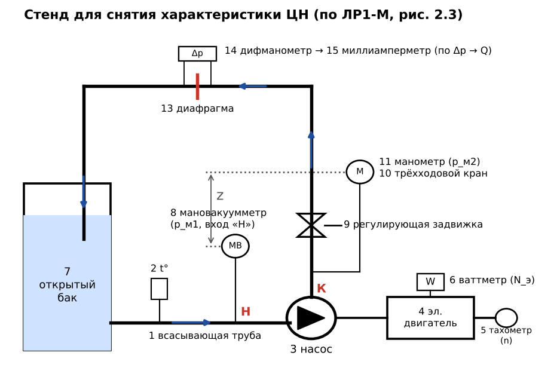

**Что нарисовать и подписать** (ЛР1-М рис. 2.3; Т1 рис. 2.40 с.53):
открытый бак 7 → всасывающая труба 1 (на ней термометр 2 и **мановакуумметр 8**, сечение «Н») → **насос 3** ⟷ муфта ⟷ **электродвигатель 4** (на нём **ваттметр 6**, на валу **тахометр 5**) → напорная труба 12 (сечение «К», **манометр 11** через трёхходовой кран 10, **регулирующая задвижка 9**) → **нормальная диафрагма 13** с **дифманометром 14** и миллиамперметром 15 → обратно в бак. Между манометром и мановакуумметром есть разница высот $z$.

**Что измеряем и как считаем:**
| Величина | Прибор | Формула |
|---|---|---|
| Подача $Q$ | диафрагма + дифманометр | $Q = \mu f_д \sqrt{2\Delta p_д/\rho}$ |
| Напор $H$ | манометр + мановакуумметр | $H = \frac{p_{м2} - p_{м1}}{\rho g} + z + \frac{c_к^2 - c_н^2}{2g}$ (при вакууме на входе $p_{м1}<0$) |
| Мощность $N$ | ваттметр | $N = N_э \eta_э$ |
| Частота $n$ | тахометр | → приведение к $n_{ном}$ по [Q04](#q04) |
| КПД | расчёт | $\eta = \rho g Q H / N$ |

- Режимы задают **задвижкой на напорной линии**, от $Q=0$ (закрыта) до $Q_{max}$ (полностью открыта). По ЛР1 нужно не менее 10 режимов, по Т1 — не менее 15.
- **Пуск — при закрытой задвижке**, потому что при $Q=0$ мощность ЦН минимальна.
- Задвижку ставят **на напорной** линии, а не на всасывающей: на всасывании дросселирование вызовет кавитацию.

📷 Оригинальная схема из методички (нажать)

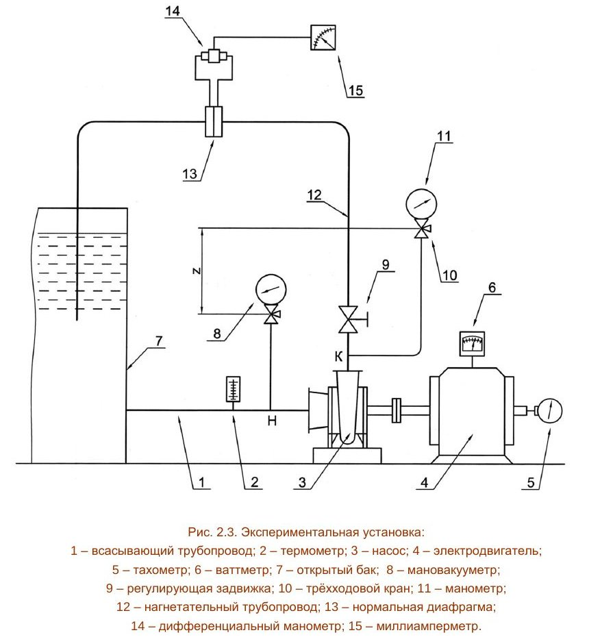

## Q03. Оптимальный (номинальный) режим, графики ⭐ 🖊
🔑 *оптимальный режим, номинальный режим, максимум КПД, рабочая часть характеристики, рабочая зона, графики H-Q N-Q η-Q, характеристика насоса*

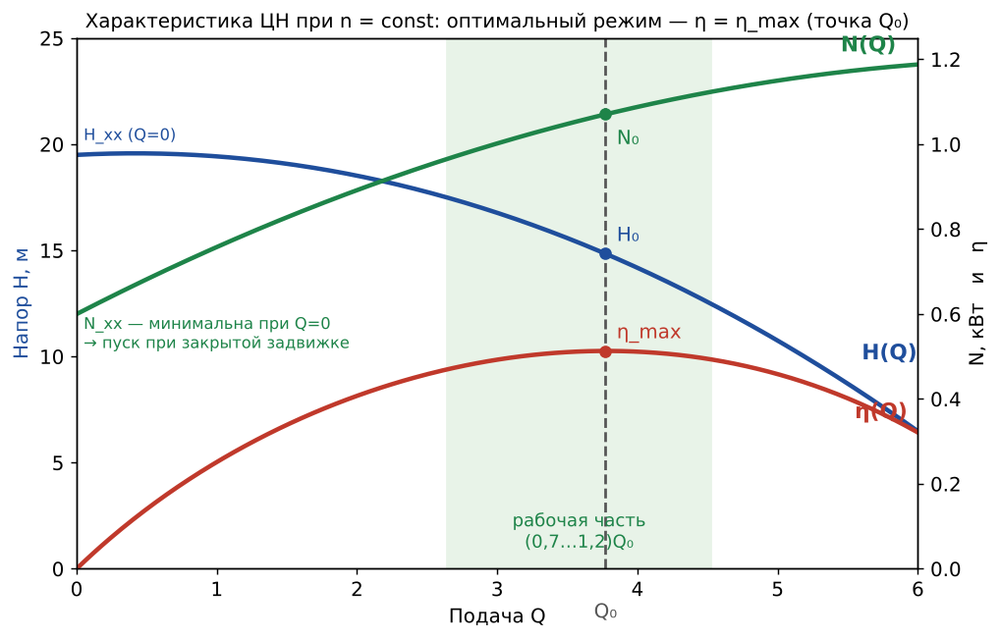

**Что рисовать:** три кривые на одном графике при $n = const$.
- **H–Q** падает: от $H_{хх}$ при $Q=0$ до нуля при $Q_{max}$. При $\beta_2 > 40°$ на кривой может быть горб, это неустойчивая зона.
- **N–Q** растёт: от $N_{хх} \ne 0$ при $Q=0$. Мощность холостого хода уходит на циркуляцию в колесе, дисковое трение и механическое трение.
- **η–Q** — купол: $\eta = 0$ при $Q = 0$ и при $H = 0$, максимум $\eta_{max}$ при $Q_0$.

**Определения** (Т1 с.42; ЛР1 с.9):
- **Оптимальный режим** — режим, где **КПД максимален**: мощность расходуется наиболее экономично. Его параметры $Q_0, H_0, N_0, \eta_{max}$ — это паспортные (номинальные) данные насоса. В справочниках, если нет оговорок, указан именно этот режим.
- **Номинальный режим** — режим, на который насос рассчитан и в котором его эксплуатируют. Обычно он совпадает с оптимальным или близок к нему.
- **Рабочая часть характеристики** — зона $Q = (0{,}7 \div 1{,}2)\,Q_0$, внутри неё КПД близок к максимальному. По ГОСТ при выборе насоса КПД может отличаться от $\eta_{max}$ не более чем на 7 % (Т1 с.61). Это и есть **поле рабочих параметров**.
- По оптимуму считают коэффициент быстроходности $n_s = 3{,}65\,n\sqrt{Q_0}/H_0^{3/4}$, а также $\varphi_0 = Q_0/(nD_2^3)$ и $\psi_0 = gH_0/(n^2D_2^2)$.
- Подпись под графиком (как в ЛР1): марка насоса, $n_{ном}$, $\rho$, $\nu$, затем $Q_0$, $H_0$, $N_0$, $\eta_{max}$, $n_s$.

## Q04. Пересчёт характеристики с частоты на частоту ⭐ 🖊
🔑 *пересчёт, другая частота вращения, формулы пропорциональности, законы подобия, n1 n2, приведение к номинальной частоте, обороты*

Формулы пропорциональности для **одного и того же насоса** ($D_2 = const$), режимы подобны, КПД считаем одинаковым (Т1 ф. 2.82–2.88, с.45–48):
$$\frac{Q_2}{Q_1} = \frac{n_2}{n_1}, \qquad \frac{H_2}{H_1} = \left(\frac{n_2}{n_1}\right)^2, \qquad \frac{p_2}{p_1} = \frac{\rho_2}{\rho_1}\left(\frac{n_2}{n_1}\right)^2, \qquad \frac{N_2}{N_1} = \frac{\rho_2}{\rho_1}\left(\frac{n_2}{n_1}\right)^3, \qquad \eta_2 = \eta_1$$

**Коротко:** подача ~ $n$, напор и давление ~ $n^2$, мощность ~ $n^3$, КПД не меняется.

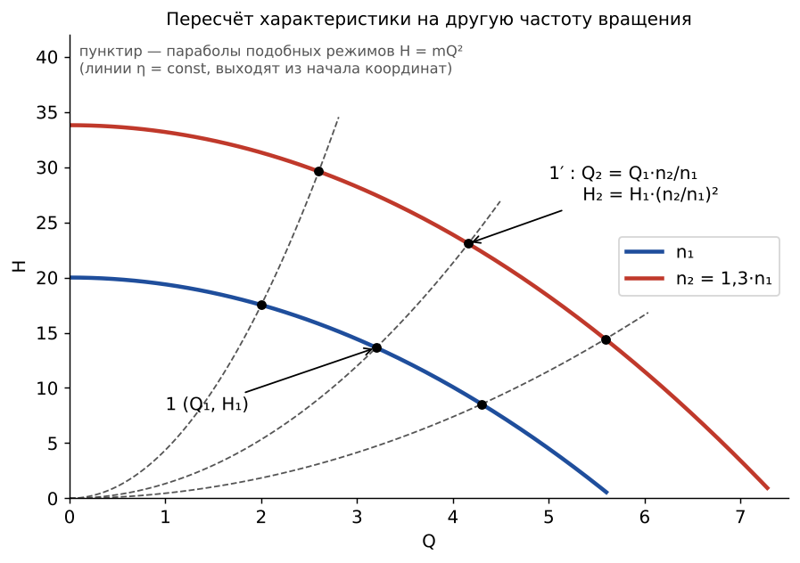

**Как строить (что рисовать):**
1. На исходной кривой $H(Q)$ при $n_1$ берём несколько точек $(Q_1, H_1)$.
2. Каждую пересчитываем: $Q_2 = Q_1 n_2/n_1$, $H_2 = H_1 (n_2/n_1)^2$. Через новые точки проводим новую кривую.
3. Соответственные точки лежат на **параболах подобных режимов** $H = mQ^2$, выходящих из начала координат. Это **линии постоянного КПД**.
4. Мощность пересчитывают так же: $N_2 = N_1 (n_2/n_1)^3$, точки лежат на кубических параболах $N = eQ^3$.
5. Кривую КПД **переносим по горизонтали**: значение $\eta$ из точки $Q_1$ ставим над $Q_2$. Кривая растягивается вдоль оси Q.

- Строго в формулах есть отношения КПД: $Q \sim n\,\eta_о$, $H \sim n^2\eta_г$, $N \sim n^3/\eta$. При небольших изменениях $n$ ими пренебрегают.
- На стенде так же **приводят опытные данные к $n_{ном}$**: $Q = Q_{оп} n_{ном}/n_{оп}$ и т. д. (ЛР1 ф. 2.4).
- ⚠️ КПД насоса постоянен при изменении $n$ только для сети без статического напора ($H = mQ^2$). Если у сети есть $H_{ст}$, рабочая точка уходит с параболы подобия и КПД меняется (Т1 с.48–49).

## Q05. Как меняется характеристика при росте вязкости ⭐ 🖊
🔑 *вязкость, вязкая жидкость, нефть, масло, пересчёт с воды, поправочные коэффициенты, kQ kH kη, fQ fH fη*

**Ответ:** с ростом вязкости **напор, подача и КПД уменьшаются, мощность растёт** (Т1 с.49–50, рис. 2.38).

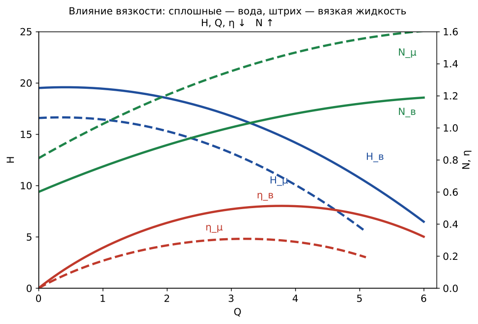

**Почему так:**
- растёт гидравлическое сопротивление проточной части, а значит и гидравлические потери, поэтому падают $H$ и $\eta_г$;
- растёт **дисковое трение** наружных поверхностей колеса о жидкость, поэтому падает $\eta_м$ и растёт $N$;
- объёмные утечки через щели при большой вязкости уменьшаются, но это не компенсирует потерь.

**Пересчёт с воды на вязкую жидкость.** Теоретически учесть вязкость нельзя, используют **опытные поправочные коэффициенты** (по справочникам и номограммам):
$$Q_\mu = f_Q Q_в, \qquad H_\mu = f_H H_в, \qquad \eta_\mu = f_\eta \eta_в, \qquad N_\mu = \frac{\rho g Q_\mu H_\mu}{\eta_\mu}$$
При вязкости 50–120 °Е и $n_s \approx 100$: $f_Q = 0{,}9…0{,}7$; $f_H = 0{,}92…0{,}65$; $f_\eta = 0{,}7…0{,}4$.

- Заводские характеристики снимают **на чистой воде** (Т1: $T \le 323$ К). Для нефти их нужно пересчитывать.
- **Что рисовать:** сплошные кривые для воды и штриховые для вязкой жидкости. $H_\mu$ и $\eta_\mu$ лежат ниже, $N_\mu$ выше, максимум КПД смещается влево (к меньшей подаче).

## Q06. Кавитация: что это, где, признаки, последствия ⭐ 🖊
🔑 *кавитация, вскипание, пузырьки, давление насыщенного пара, питтинг, эрозия, шум, вибрация, срыв, стадии кавитации*

**Определение** (ЛР2-К с.1; Т1 с.73–75): кавитация — образование в потоке жидкости парогазовых пузырьков **там, где давление падает до давления насыщенного пара** $p_{н.п}$ при данной температуре, и их последующее **захлопывание** в зоне повышенного давления. Захлопывание сопровождается **гидравлическими микроударами высокой частоты** с местными давлениями до нескольких МПа и высокой температурой.

**Условие возникновения:** $p_{min} \le p_{н.п}$.

**Где возникает:** у **входа на лопасти рабочего колеса, на их вогнутой (рабочей) стороне**. Там относительная скорость $w$ наибольшая, а давление наименьшее. В многоступенчатом насосе сильнее всего кавитирует **первое колесо**.

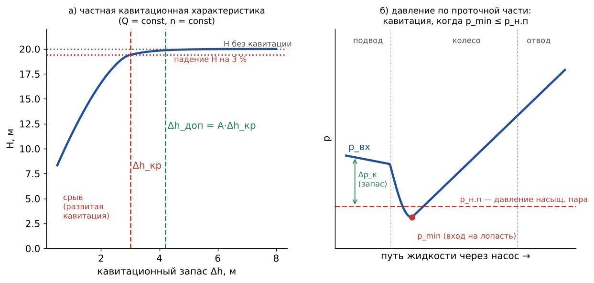

**Признаки и последствия:**
- **шум, треск, удары, вибрация**;
- **падение напора, подачи и КПД**, при развитой кавитации — **срыв работы** насоса;
- **кавитационная эрозия (питтинг)**: точечное разрушение металла лопастей и подвода. У чугуна поверхность становится губчатой, у стали появляются гладкие впадины. Разрушению помогают термические и электрохимические процессы;
- кавитация **ограничивает высоту всасывания** и частоту вращения насоса.

**Стадии** (Т1 с.75):
1. **Начальная** — в зоне есть смесь жидкости и пузырьков. Нежелательна, но допустима при кавитационно стойких материалах.
2. **Развитая** — на поверхности образуются крупные каверны, они срываются и образуются снова. **Недопустима.**
3. **Суперкавитация** — весь обтекаемый элемент находится внутри каверны. **Недопустима.**

**Почему возникает (что приводит к кавитации):** большая высота всасывания; большое сопротивление всасывающей линии (длинная или узкая труба, грязный фильтр, задвижка на всасывании); высокая температура жидкости, а значит высокое $p_{н.п}$; низкое давление над жидкостью; слишком большая частота вращения; подача больше расчётной; газ в жидкости.

## Q07. Методы борьбы с кавитацией ⭐
🔑 *борьба с кавитацией, предотвращение кавитации, меры против кавитации, бескавитационная работа, подпор, шнек, предвключённое колесо, кавитационный запас*

Главное правило: **обеспечить кавитационный запас больше критического**, $\Delta h > \Delta h_{доп} = A\,\Delta h_{кр}$, то есть **высота всасывания не должна превышать допустимую** (Т1 с.76, ЛР2-К).

**Эксплуатационные (на установке):**
1. **Уменьшить геометрическую высоту всасывания** или установить насос **ниже уровня жидкости, с подпором**. Для горячей воды бак ставят выше насоса.
2. **Снизить потери во всасывающей линии**: увеличить диаметр трубы, укоротить её, убрать лишние повороты и местные сопротивления, чистить фильтр.
3. **Не ставить регулирующую задвижку на всасывании**: регулировать только на напорной линии.
4. **Повысить давление над жидкостью** в приёмной ёмкости (наддув, герметичный бак под давлением).
5. **Понизить температуру** жидкости: при этом падает $p_{н.п}$.
6. Работать **около расчётного режима**, не превышать подачу и частоту вращения: допустимая высота всасывания падает с ростом $Q$ и $n$.
7. Использовать **бустерный (подпорный) насос**.

**Конструктивные (в насосе):**
8. **Предвключённое осевое колесо или шнек** (2–3 витка) перед первым колесом: он поднимает давление на входе.
9. **Рациональный вход в колесо**: увеличенный входной диаметр $D_0$, меньшие скорости, хорошие профили и входные кромки лопастей, плавный подвод.
10. **Колесо двустороннего входа**: скорость на входе уменьшается вдвое.
11. **Кавитационно стойкие материалы**: нержавеющие хромоникелевые стали, бронзы, наплавки, покрытия. Чугун и керамика стоят плохо. Абсолютно стойких материалов нет.
12. Иногда помогает **подвод воздуха** во всасывающую линию: смягчает удары, но снижает напор.

## Q08. Осевая сила в ЦН ⭐ 🖊
🔑 *осевая сила, осевое усилие, сила вдоль вала, гидравлическая осевая сила, давление на диски колеса, пазухи*

**Откуда берётся** (Т1 §2.9 с.34–36):
1. **Разность давлений на диски колеса.** С задней стороны давление выхода $p_2$ действует на весь диск до втулки, $R_в…R_2$. С передней стороны от $R_у$ до $R_2$ оно уравновешено, а **от $R_в$ до $R_у$ (зона входа) действует только давление всасывания $p_1 < p_2$**. Поэтому колесо **прижимается в сторону всасывания**.
2. В пазухах жидкость вращается с угловой скоростью ≈ $\omega/2$, поэтому давление к центру падает по параболе:
   $$p = p_2 - \rho\frac{\omega^2}{8}(R_2^2 - r^2)$$
3. **Динамическая составляющая** $P_{дин} = \rho Q c_0$ возникает от поворота потока из осевого направления в радиальное. Она направлена против основной силы и немного её уменьшает.

**Формула на одно колесо:**
$$P_{ос} = \pi(R_у^2 - R_в^2)(p_2 - p_1) - \frac{\pi\rho\omega^2}{8}(R_у^2 - R_в^2)\left[R_2^2 - 0{,}5(R_у^2 + R_в^2)\right] - \rho Q c_0$$
Для $i$ ступеней $P_{ос} = i\,P'_{ос}$. В крупных многоступенчатых насосах это **десятки тонн**.

**От чего зависит:** от $R_2$, $R_у$, частоты вращения и давления $p_2$. **Чем меньше подача, тем больше осевая сила; максимальна на холостом ходу** ($Q=0$): $p_2$ максимально, а динамической составляющей нет.

**Чем опасна:** сдвигает ротор, колесо задевает корпус, перегружаются и выходят из строя подшипники.

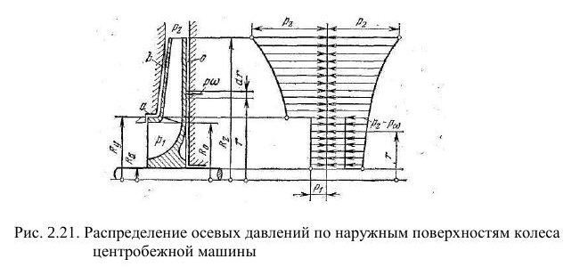

**Что рисовать:** полуразрез колеса; слева $p_1$ на зоне $R_в…R_у$, справа параболическая эпюра $p_2 - p_\omega$; стрелка $P_{ос}$ в сторону входа.

## Q09. Методы уравновешивания (разгрузки) осевой силы ⭐ 🖊
🔑 *уравновешивание осевой силы, разгрузка, разгрузочный диск, гидропята, разгрузочные отверстия, двусторонний вход, встречное расположение колёс, упорный подшипник, думмис*

(Т1 с.36–38, рис. 2.22–2.25)
1. **Колесо с двусторонним входом.** Из-за симметрии осевая сила на вал не передаётся. Применяют в одноступенчатых насосах (тип Д).
2. **Симметричное (встречное) расположение колёс** в многоступенчатом насосе с чётным числом колёс: две группы колёс обращены входами в разные стороны, их силы взаимно гасятся. **Один из лучших способов, КПД не снижается**. Остаточную силу воспринимает шариковый подпятник.
3. **Разгрузочные отверстия в заднем (основном) диске плюс уплотняющее кольцо** на заднем диске на радиусе $R_у$ (или обводная трубка из задней пазухи на всасывание). Давления по обе стороны выравниваются, остаётся только малая динамическая сила. Просто и широко распространено. ⚠️ **Минусы:** немного падает **объёмный КПД** (перетекание) и портится поток на входе в колесо.
4. **Разгрузочный диск (гидравлическая пята)** в многоступенчатых насосах. Диск стоит на валу **за последним колесом**: с одной стороны на него давит $p_2$ (через радиальный зазор), с другой — давление всасывания (полость за диском соединена трубкой со всасыванием). **Сам авторегулируется**: при сдвиге ротора меняется торцевой зазор $\delta_a$, а с ним давление за диском, и ротор возвращается. ⚠️ **Минус:** утечки, снижение КПД. **В одноступенчатых насосах не применяется.**
5. **Упорный подшипник** — только для небольших насосов с малым числом ступеней.
6. Иногда добавляют **разгрузочный поршень (барабан, думмис)** или **импеллеры (рёбра) на заднем диске**, они снижают давление в задней пазухе (из общих знаний).

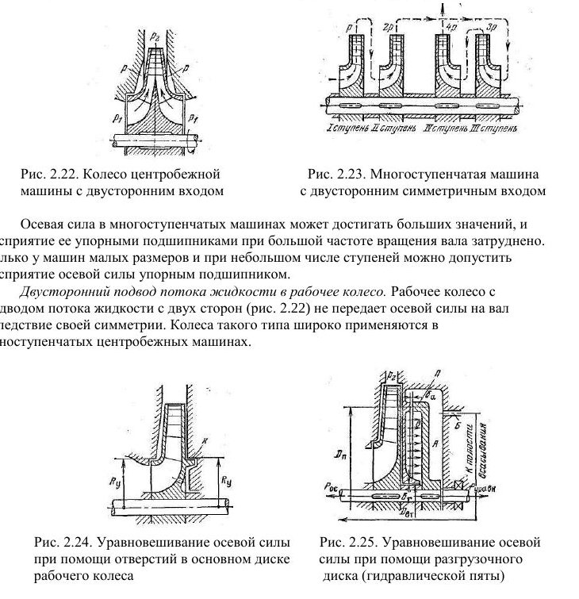
*Рис. 2.22 — двусторонний вход; 2.23 — встречные колёса; 2.24 — отверстия + кольцо; 2.25 — разгрузочный диск.*

## Q10. Принцип действия центробежного насоса ⭐ 🖊
🔑 *принцип действия ЦН, как работает центробежный насос, центробежная сила, рабочее колесо, спиральный отвод, лопастной насос*

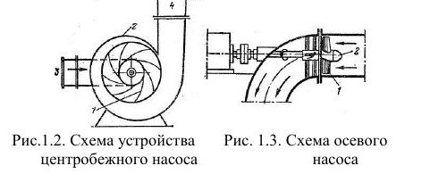

**Схема (рис. 1.2 Т1):** 1 — рабочее колесо с лопастями (загнуты назад), 2 — спиральный корпус (отвод), 3 — входной патрубок (осевой вход), 4 — напорный патрубок.

**Принцип** (Т1 с.4, с.13–14): ЦН — **динамический лопастной** насос.
1. Двигатель вращает вал с **рабочим колесом**. Колесо состоит из двух дисков (ведущего и покрывающего) и лопастей между ними.
2. Жидкость входит в колесо **вдоль оси** через входной патрубок, попадает в межлопастные каналы и вращается вместе с ними.
3. Под действием **центробежных сил** жидкость движется **от центра к периферии**. Лопасти передают ей энергию: растут давление и скорость.
4. Из колеса жидкость выбрасывается в **спиральный отвод (улитку)** или **направляющий аппарат**. Там сечение расширяется, **скорость падает и кинетическая энергия переходит в давление** (через диффузор), после чего жидкость уходит в напорный трубопровод.
5. В центре колеса давление понижено, поэтому **жидкость непрерывно всасывается**. Камера постоянно сообщена и с входом, и с выходом, поэтому подача **равномерная**.

Повышение давления в колесе (Т1 ф. 2.1) складывается из работы центробежных сил и замедления относительного движения:
$$p_2 - p_1 = \frac{\rho}{2}(u_2^2 - u_1^2) + \frac{\rho}{2}(w_1^2 - w_2^2)$$
Напор задаёт **уравнение Эйлера** $H_т = u_2 c_{2u}/g$ (см. [Q16](#q16)).

**Особенности:** ЦН **не самовсасывающий**, перед пуском его заливают. Пуск ведут при закрытой задвижке. Подачу регулируют задвижкой. $n_s = 40…300$.

## Q11. Принцип действия осевого насоса ⭐ 🖊
🔑 *осевой насос, пропеллерный, принцип действия осевого, лопасти на втулке, подъёмная сила крыла*

**Схема (рис. 1.3 Т1, справа на картинке выше):** 1 — лопасти, 2 — втулка; поток входит вдоль оси, на выходе поворачивает в колене; вал выведен через колено к двигателю.

**Принцип** (Т1 с.4):
1. Рабочее колесо — **втулка с лопастями-крыльями**, установленными под углом к плоскости, перпендикулярной оси.
2. При вращении лопасти обтекаются, как **крыло**. На них возникает **подъёмная сила** (по Жуковскому), а реакция лопастей закручивает поток и толкает его **вдоль оси**, увеличивая давление.
3. Жидкость входит и выходит **параллельно оси**, радиального перемещения почти нет, поэтому центробежные силы роли не играют.
4. За колесом стоит **выправляющий (направляющий) аппарат**: он снимает закрутку и превращает её кинетическую энергию в давление.

**Особенности:**
- **Большая подача, малый напор**; $n_s = 600…1200$, это самые быстроходные насосы.
- Мощность **падает** с ростом подачи и максимальна при $Q=0$. Поэтому осевой насос **пускают при открытой задвижке**, а испытание начинают с режима максимальной подачи (Т1 с.53, с.87).
- Характеристика H–Q крутая, часто с седловиной (зоной неустойчивости).
- Регулируют **поворотом лопастей** (поворотно-лопастные насосы) или изменением частоты вращения; дросселирование невыгодно.
- **Сравнение с ЦН:** в ЦН поток в колесе радиальный и работают центробежные силы. В осевом поток осевой, а энергию передаёт подъёмная сила лопастей. Промежуточный тип — **диагональный** насос ($n_s = 300…600$).

## Q12. Напор по показаниям манометра и вакуумметра
🔑 *напор по приборам, манометр, вакуумметр, мановакуумметр, измерение напора, разность показаний*

Напор — это разность полных удельных энергий на выходе (к) и входе (н) насоса (ЛР1 с.3; Л01 сл.30):
$$H = \frac{p_к - p_н}{\rho g} + (z_к - z_н) + \frac{c_к^2 - c_н^2}{2g}$$
Если на входе вакуум, то $p_м = p_к - p_{атм}$, $p_{вак} = p_{атм} - p_н$, и:
$$H = \frac{p_м + p_{вак}}{\rho g} + z + \frac{c_к^2 - c_н^2}{2g}$$
Скорости считаются как $c = 4Q/(\pi D^2)$. Если диаметры патрубков равны, последнее слагаемое равно 0. Если приборы стоят на одной высоте, $z = 0$.

## Q13. Вакуумметрическая высота всасывания
🔑 *вакуумметрическая высота всасывания, Hвак, допускаемая высота всасывания, вакуум на входе*

**Определение** (Л01 сл.29): численно равна **вакууму во входном патрубке, выраженному в метрах столба перекачиваемой жидкости**:
$$H_{вак} = \frac{p_а - \left(p_н + \rho c_н^2/2\right)}{\rho g}$$
- **Допускаемая** $H_{вак.доп}$ — та, при которой насос работает **без изменения основных показателей**, то есть без кавитации.
- Для насоса, стоящего выше уровня жидкости в открытом баке, по уравнению Бернулли от уровня до входа: $H_{вак} = H_{г.вс} + h_{вс}$. Это геометрическая высота всасывания плюс потери во всасывающей линии; скоростной напор уже учтён в определении $H_{вак}$.
- Допустимая геометрическая высота: $H_{г.вс.доп} = H_{вак.доп} - h_{вс}$.
- Через кавитационный запас: $H_{г.вс.доп} = \frac{p_а - p_{н.п}}{\rho g} - \Delta h_{доп} - h_{вс}$ (см. [Q26](#q26)).

## Q14. Классификация насосов и проточных машин
🔑 *классификация, динамические, объёмные, лопастные, проточные машины, машины-орудия, машины-двигатели, вентилятор газодувка компрессор*

- **Проточная машина** — машина, у которой передача работы целиком связана с потоком среды через неё (Т1 с.1; Л01).
  - По среде: **гидравлические** (насосы, гидродвигатели, гидропередачи) и **газовые** (компрессоры, газодувки, вентиляторы, пневмодвигатели).
  - По направлению передачи энергии: **машины-орудия** (насосы, компрессоры) — работа идёт от вала к потоку; **машины-двигатели** (турбины, гидромоторы) — от потока к валу.
- **По принципу действия** (ГОСТ 17398-72):
  - **Динамические** — энергия передаётся в камере, **постоянно** сообщённой со входом и выходом. Это **лопастные** (центробежные, осевые, диагональные) и **насосы трения** (вихревые, струйные, шнековые, дисковые).
  - **Объёмные** — рабочая камера **периодически меняет объём** и **попеременно** сообщается со входом и выходом. Это **возвратно-поступательные** (поршневые, плунжерные, диафрагменные) и **роторные** (шестерённые, винтовые, пластинчатые, роторно-поршневые).
  - **Насосы-аппараты** без движущихся частей: струйные, эрлифт (газлифт), вытеснители.
- **По степени повышения давления ε** (газ): вентилятор — $\varepsilon = 1…1{,}15$; газодувка — $\varepsilon > 1{,}15$ без охлаждения; компрессор — $\varepsilon > 1{,}15$ с искусственным охлаждением.

## Q15. Устройство ЦН: колесо, подвод, отвод
🔑 *устройство центробежного насоса, рабочее колесо, подвод, отвод, спиральный отвод, улитка, направляющий аппарат, диффузор, уплотнения*

- **Рабочее колесо** (Т1 с.13): **ведущий (основной) диск** со ступицей на валу, **покрывающий (передний) диск** и **лопасти** между ними (обычно 6–8, загнуты назад). Бывают закрытые, полуоткрытые и открытые колёса; с односторонним или двусторонним входом.
- **Подвод** — подводит жидкость к колесу **равномерно и осесимметрично** с малыми потерями. Бывает прямоосный конфузор (осевой вход) или спиральный (боковой вход).
- **Отвод** — собирает жидкость с колеса и **превращает часть кинетической энергии в давление**. Типы: **кольцевой, спиральный (улитка) с диффузором** (угол раскрытия ≈10°), **лопаточный (направляющий аппарат)** в многоступенчатых насосах, там же **обратный направляющий аппарат**.
- Остальные узлы: **корпус** (с горизонтальным разъёмом или секционный), **вал**, **подшипники**, **уплотнения вала** (сальник, торцовое), **щелевые уплотнения колеса** (защитные кольца), разгрузочные устройства.

## Q16. Уравнение Эйлера, треугольник скоростей, напор
🔑 *уравнение Эйлера, основное уравнение центробежной машины, теоретический напор, треугольник скоростей, параллелограмм скоростей, u w c, бесконечное число лопастей*

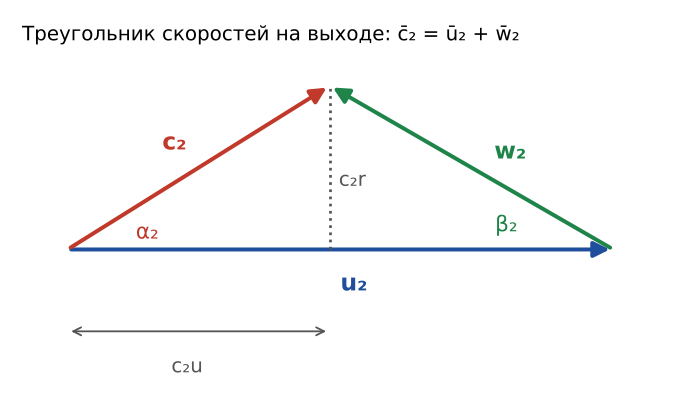

**Скорости:** $u$ — окружная (переносная), $u = \omega R = \pi D n/60$; $w$ — относительная, направлена по лопасти; $c$ — абсолютная, $\bar c = \bar u + \bar w$. Составляющие: $c_u$ — окружная, $c_r$ — радиальная (меридиональная), $c_r = Q/(\pi D_2 b_2)$.

**Уравнение Эйлера** (1754) получено из закона моментов количества движения. Оно справедливо при бесконечном числе бесконечно тонких лопастей и без потерь (Т1 ф. 2.8):
$$H_{т\infty} = \frac{u_2 c_{2u} - u_1 c_{1u}}{g}$$
При **радиальном входе** ($c_{1u} = 0$, $\alpha_1 = 90°$) оно упрощается до $H_{т\infty} = u_2 c_{2u}/g$.

Развёрнутая форма показывает, из чего складывается напор:
$$H_{т\infty} = \frac{u_2^2 - u_1^2}{2g} + \frac{w_1^2 - w_2^2}{2g} + \frac{c_2^2 - c_1^2}{2g}$$
Первое слагаемое — работа центробежных сил, второе — замедление относительного движения, третье — рост скоростного напора.

**Действительный напор** (Т1 ф. 2.17–2.18): $H = \eta_г\,\mu\,H_{т\infty}$.
- $\mu \approx 0{,}8$ учитывает **конечное число лопастей**: из-за осевого вихря в канале $c_{2u}$ уменьшается. Считают по формуле Стодолы или Пфлейдерера.
- $\eta_г = 0{,}8…0{,}96$ учитывает гидравлические потери.

**Теоретическая характеристика** — прямая: $H_{т\infty} = C - EQ$, где $C = u_2^2/g$, $E = \dfrac{u_2\,\mathrm{ctg}\beta_2}{g\pi D_2 b_2}$. Наклон прямой зависит от $\beta_2$.

## Q17. Форма лопастей, угол β₂
🔑 *угол β2, лопасти загнуты назад, вперёд, радиальные, степень реактивности, статический и динамический напор*

(Т1 §2.4, с.18–22)
| | $\beta_{2л}$ | Напор $H_т$ | Что преобладает | Степень реактивности ρ |
|---|---|---|---|---|
| Загнуты **назад** | < 90° | наименьший | статический (давление) | 0,5…1 |
| **Радиальные** | = 90° | $u_2^2/g$ | поровну | 0,5 |
| Загнуты **вперёд** | > 90° | наибольший | скоростной (кинетическая энергия) | 0…0,5 |

- Степень реактивности $\rho = H_{ст}/H_т$.
- Чем меньше ρ, тем больше скоростного напора, который приходится преобразовывать в диффузоре с потерями, и тем **ниже КПД**.
- В **насосах применяют лопасти, загнутые назад** ($\beta_2 \approx 15…40°$): у них выше КПД и устойчивая, монотонно падающая характеристика H–Q.
- Теоретическая характеристика: при $\beta_2 < 90°$ напор падает с ростом $Q$, при 90° постоянен, при $> 90°$ растёт.

## Q18. Потери и КПД насоса
🔑 *потери энергии, гидравлический КПД, объёмный КПД, механический КПД, полный КПД, утечки, дисковое трение, внутренняя мощность*

(Т1 §2.7, с.29–31)
| Потери | Где возникают | КПД | Типичные значения |
|---|---|---|---|
| **Гидравлические** $h$ | трение и вихри в проточной части | $\eta_г = \frac{H}{H + h} = \frac{H}{H_т}$ | 0,80…0,96 |
| **Объёмные** (утечки $\Delta Q$) | перетекание через щелевые уплотнения с выхода обратно на вход, через разгрузочные отверстия | $\eta_о = \frac{Q}{Q + \Delta Q}$ | 0,96…0,98 |
| **Механические** | трение в подшипниках, уплотнениях вала, **дисковое трение** колеса о жидкость | $\eta_м = \frac{N_{вн}}{N}$ | 0,92…0,95 |

Полный КПД и мощность:
$$\eta = \eta_г\,\eta_о\,\eta_м = 0{,}75…0{,}92, \qquad N = \frac{\rho g Q H}{\eta}$$
Внутренняя мощность $N_{вн} = \rho g (Q + \Delta Q)(H + h)$.

- Дисковое трение $N_{тр} \sim \rho R_2^5 \omega^3$, поэтому выгоднее **меньший диаметр колеса и большая частота вращения**.
- Мощность двигателя берут с запасом: $N_{дв} = k\,\rho g Q H/\eta$, $k = 1{,}1…1{,}5$.

## Q19. Характеристика насоса: определение, виды, типы
🔑 *характеристика насоса определение, напорная характеристика, энергетическая характеристика, рабочая характеристика, типы характеристик, пологая, крутая, с максимумом, кавитационная характеристика*

- **Определение** (ЛР1 с.1): характеристика ЦН — **графическая зависимость основных технических показателей ($H$, $N$, $\eta$) от подачи** при постоянных частоте вращения, плотности и вязкости жидкости на входе.
- **Теоретическая** характеристика — прямая $H_т = C - EQ$. **Действительная** лежит ниже на величину потерь: гидравлических и ударных на входе при режимах, отличных от расчётного.
- Две формы H–Q (Т1 с.41):
  - при $\beta_2 < 40°$ — **монотонно падающая**, устойчивая;
  - при $\beta_2 > 40°$ — **с максимумом (горбом)**: одному напору отвечают две подачи, работа может быть неустойчивой (помпаж).
- **Типы по $n_s$** (Т1 с.87):
  - тихоходный — H–Q с максимумом, N круто растёт;
  - нормальный и быстроходный — H монотонно падает, N пологая;
  - диагональный и осевой — H крутая с впадиной, **N падает с ростом Q**.
- Чем выше $n_s$, тем **круче** H–Q.
- Ещё бывают: **универсальная (топографическая)** характеристика с линиями постоянного КПД при разных $n$ (Т1 с.52); **безразмерная** — $\bar Q$, $\bar H$; **кавитационная** — $H(\Delta h)$ (см. [Q26](#q26)).

## Q20. Подобие насосов, формулы подобия
🔑 *подобие, геометрическое кинематическое динамическое подобие, формулы подобия, модель, натура, серия насосов, диаметр колеса*

- **Условия подобия** (Т1 §2.12):
  - **геометрическое** — равные углы и пропорциональные размеры;
  - **кинематическое** — подобные треугольники скоростей (равные углы, пропорциональные скорости);
  - **динамическое** — пропорциональные силы, то есть равенство критериев Re, Eu, Fr, Sh.
- **Формулы подобия** для подобных насосов $a$ и $b$:
$$\frac{Q_a}{Q_b} = \frac{n_a}{n_b}\left(\frac{D_a}{D_b}\right)^3, \qquad \frac{H_a}{H_b} = \left(\frac{n_a}{n_b}\right)^2\left(\frac{D_a}{D_b}\right)^2, \qquad \frac{N_a}{N_b} = \frac{\rho_a}{\rho_b}\left(\frac{n_a}{n_b}\right)^3\left(\frac{D_a}{D_b}\right)^5$$
  (строго ещё с множителями $\eta_о$, $\eta_г$, $1/\eta$).
- Давление насоса пропорционально **плотности** жидкости, а напор от плотности **не зависит**.
- Для одного насоса при разных $n$ эти формулы превращаются в **формулы пропорциональности** (см. [Q04](#q04)).
- С ростом размеров насоса КПД немного растёт.

## Q21. Коэффициент быстроходности n_s
🔑 *коэффициент быстроходности, удельная частота вращения, ns, тип колеса, тихоходный, быстроходный*

$$n_s = 3{,}65\,\frac{n\sqrt{Q}}{H^{3/4}} \qquad (n \text{ — об/мин},\ Q \text{ — м}^3/\text{с},\ H \text{ — м, в оптимальном режиме})$$
- **Смысл:** это частота вращения насоса, геометрически подобного данному, который при $\eta_{max}$ даёт напор 1 м при полезной мощности 1 л. с. (т. е. 0,075 м³/с). Это **критерий подобия**: у подобных насосов $n_s$ одинаков (Т1 с.46–47).
- Для многоступенчатого насоса берут напор **одной ступени**, для колеса с двусторонним входом — $Q/2$.

| Тип насоса или колеса | $n_s$ | $D_2/D_0$ |
|---|---|---|
| поршневые, роторные | < 40 | — |
| вихревые | 10…40 | — |
| ЦН тихоходный | 40…80 | ≈2,5 |
| ЦН нормальный | 80…150 | ≈2 |
| ЦН быстроходный | 150…300 | ≈1,4…1,8 |
| диагональный | 300…600 | ≈1,2 |
| осевой | 600…1200 | ≈0,8 |

С ростом $n_s$ колесо становится шире и «короче» по радиусу: тип переходит от радиального к осевому, подача растёт, напор падает.

## Q22. Обточка (обрезка) рабочего колеса
🔑 *обточка, обрезка колеса, уменьшение диаметра, расширение поля, парабола обрезок*

- **Обточка** — уменьшение наружного диаметра $D_2$ на токарном станке при той же форме лопастей. Это способ **подогнать насос под нужную рабочую точку** и расширить его поле применения (Т1 с.61–62).
- Подобие при этом нарушается, поэтому используют **опытные** формулы:
$$\frac{Q}{Q_{обр}} = \frac{D_2}{D_{2обр}}, \qquad \frac{H}{H_{обр}} = \left(\frac{D_2}{D_{2обр}}\right)^2, \qquad \frac{N}{N_{обр}} \approx \left(\frac{D_2}{D_{2обр}}\right)^3$$
  Соответственные точки лежат на **параболе обрезок** $H = aQ^2$.
- Допустимая обрезка **тем больше, чем меньше $n_s$**: до 15–20 % при $n_s \approx 60…100$ и до 7–10 % при $n_s \approx 300$. При небольшой обрезке КПД почти не меняется.

## Q23. Работа насоса на сеть, рабочая точка 🖊
🔑 *насос и сеть, характеристика сети, характеристика трубопровода, рабочая точка, режимная точка, статический напор*

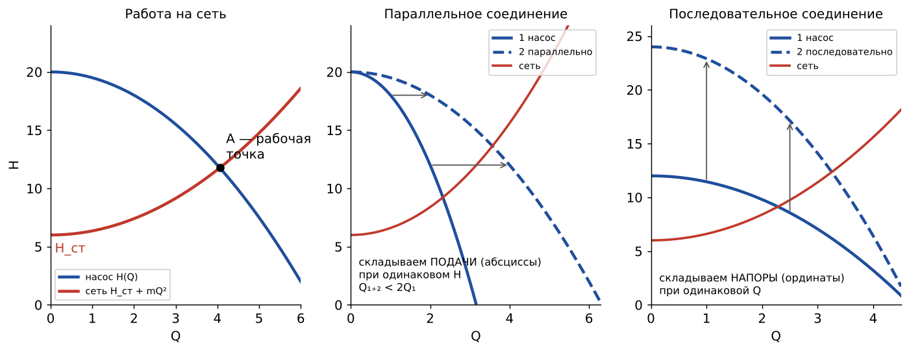

- **Характеристика сети** — напор, который сеть требует для пропуска подачи $Q$ (Т1 ф. 1.21):
$$H_с = \underbrace{\frac{p_2 - p_1}{\rho g} + H_г}_{H_{ст}} + mQ^2$$
  Это парабола, начинающаяся с ординаты $H_{ст}$.
- **Рабочая точка** — пересечение характеристики насоса $H(Q)$ и характеристики сети. Это **единственный возможный установившийся режим**: напор насоса равен напору, который требует сеть. По её $Q$ на других кривых находят $N$ и $\eta$.
- Условия связи насоса и сети: подачи насоса и сети равны (неразрывность), напоры равны (энергия).
- Если растёт $p_2$ или $H_г$, или прикрывают задвижку, рабочая точка смещается **влево-вверх** по характеристике насоса: $Q$ уменьшается, $H$ растёт.
- Лучше всего, когда рабочая точка попадает в **рабочую часть** около $Q_0$.

## Q24. Регулирование подачи 🖊
🔑 *регулирование подачи, дросселирование, задвижка, частотное регулирование, изменение частоты вращения, перепуск, байпас, направляющий аппарат, поворот лопастей*

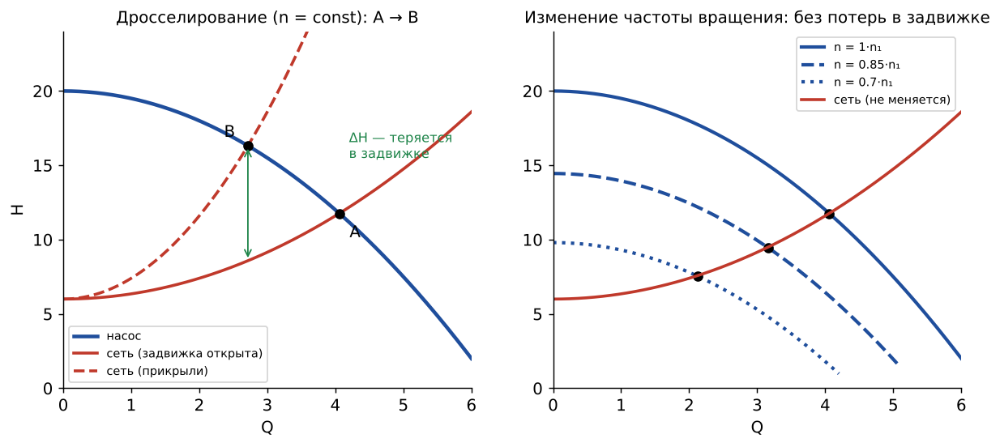

(Т1 §2.16)
1. **Дросселирование задвижкой на напорной линии** ($n = const$). Сеть становится круче, рабочая точка идёт влево-вверх. Можно **только уменьшать** подачу. **Неэкономично**: напор $\Delta H$ теряется в задвижке. Зато **просто**, поэтому используется очень широко. **На всасывании дросселировать нельзя** — будет кавитация. Дросселировать имеет смысл, только если N растёт с Q (как у ЦН). У осевых насосов N растёт при уменьшении Q, поэтому для них дросселирование бессмысленно.
2. **Изменение частоты вращения**: частотно-регулируемый привод, вариатор, гидромуфта, турбопривод. Подачу можно менять **в обе стороны**, потерь в задвижке нет, это **самый экономичный** способ. Минус — дорогой привод.
3. **Смешанное**: ступенчатое изменение $n$ плюс дросселирование.
4. **Поворотный направляющий аппарат на входе** (закрутка потока меняет $c_{1u}$ в уравнении Эйлера). Экономичнее дросселирования, применяется в вентиляторах и дымососах.
5. **Поворот лопастей** рабочего колеса (осевые насосы).
6. **Перепуск (байпас)** части подачи с напора на всасывание. Неэкономично, нужно для объёмных насосов и для защиты от помпажа.
7. **Изменение числа работающих насосов** (параллельная работа), **обточка колеса**.

## Q25. Параллельная и последовательная работа насосов 🖊
🔑 *параллельное соединение, последовательное соединение, совместная работа насосов, суммарная характеристика, два насоса*

(Т1 §2.18; картинка — в [Q23](#q23))
- **Параллельно** — чтобы увеличить подачу и покрыть переменный график расхода. **Суммарная характеристика: при одинаковом напоре складываем подачи (абсциссы)**. Подача двух одинаковых насосов **меньше удвоенной** подачи одного: $Q_{1+2} < 2Q_1$. Чем круче сеть, тем меньше выигрыш. Если один насос отключить, оставшийся сам увеличит подачу и мощность. Параллельно лучше включать насосы с **пологими** H–Q и с близкими напорами.
- **Последовательно** — чтобы увеличить напор: напорный патрубок первого соединён со всасывающим второго. **Суммарная характеристика: при одинаковой подаче складываем напоры (ординаты)**. Напор растёт, подача тоже увеличивается. Многоступенчатый насос — это последовательное соединение колёс.
- В обоих случаях рабочая точка — пересечение суммарной характеристики с характеристикой сети.

## Q26. Кавитационный запас, NPSH, допустимая высота всасывания
🔑 *кавитационный запас, NPSH, Δh, Δhкр, Δhдоп, критический кавитационный запас, допустимая высота всасывания, кавитационная характеристика, кавитационный коэффициент быстроходности, C Руднева*

- **Кавитационный запас** — превышение **полного** напора (давления) жидкости на входе в насос над давлением насыщенного пара (ЛР2-К):
$$\Delta h = \frac{p_н}{\rho g} + \frac{c_н^2}{2g} - \frac{p_{н.п}}{\rho g} \qquad (\text{NPSH, net positive suction head})$$
- **Критический** $\Delta h_{кр}$ — запас, при котором на **частной кавитационной характеристике** $H(\Delta h)$ ($Q, n = const$) напор падает на **3 %**. По Т2 и ГОСТ 6134 используют 2 % или 1 м.
- **Допускаемый** $\Delta h_{доп} = A\,\Delta h_{кр}$, где $A = 1{,}1…1{,}5$ — коэффициент запаса. По Т1 запас ≈25 %.
- **Допустимая геометрическая высота всасывания** (насос выше уровня, открытый бак):
$$H_{г.вс.доп} = \frac{p_а - p_{н.п}}{\rho g} - \Delta h_{доп} - h_{вс}$$
  Если получилось $H_{г.вс.доп} < 0$, насос ставят **ниже уровня (под залив)**. Допустимая высота **уменьшается** при росте $Q$, $n$ и температуры, а также при снижении давления над жидкостью.
- **Кавитационный коэффициент быстроходности Руднева** (Т1 ф. 2.117): $C = \dfrac{5{,}62\,n\sqrt{Q}}{\Delta h_{кр}^{3/4}}$, или в форме Т1 $C = n\sqrt{Q}/(\Delta h_{кр}/10)^{3/4}$. Для обычных насосов $C = 800…1000$, для начальной стадии кавитации 900…1500, для насосов со шнеком 2000–4000. Отсюда $\Delta h_{кр} = 10\,(n\sqrt{Q}/C)^{4/3}$.
- **Кавитационная характеристика** (картинка — в [Q06](#q06)):
  - частная: $H$ (и $\eta$) в зависимости от $\Delta h$ (или от $H_{вак}$) при $Q, n = const$. Сначала горизонтальная, затем резкий срыв;
  - отмечают **I критический режим** (начало падения) и **II критический** (срыв, полное развитие кавитации);
  - на паспорт выносят зависимость $\Delta h_{доп}(Q)$ или $H_{вак.доп}(Q)$.
- **Стенд для кавитационных испытаний** — **закрытый**: над жидкостью в герметичном баке вакуум-насосом понижают давление при постоянных $Q$ и $n$.

## Q27. Радиальная сила
🔑 *радиальная сила, поперечная сила, нагрузка на подшипники, двухзаходная спираль*

- **Причина:** несимметричный поток на выходе из колеса из-за **спирального отвода**. Давление по окружности колеса постоянно **только в оптимальном режиме** $Q_0$. При $Q < Q_0$ спираль работает как диффузор, при $Q > Q_0$ — как конфузор (Т1 с.38).
- Для спирального отвода: $P_r = k_r(1 - Q/Q_0)\,\rho g H D_2 b_2$, $k_r \approx 0{,}36$. Максимум при $Q=0$, минимум около $Q_0$.
- Другие причины: неуравновешенность ротора, неточности изготовления и монтажа.
- **Как уменьшить:** **двухзаходная (двойная) спираль**, **направляющий аппарат (канальный отвод)**, работа около $Q_0$, балансировка ротора.

## Q28. Многоступенчатые и многопоточные насосы
🔑 *многоступенчатый, ступени, секционный, ЦНС, многопоточный, двусторонний вход, обратный направляющий аппарат*

- Напор одного колеса ограничен окружной скоростью: для чугуна ≤40 м/с, для стали — до 300 м/с. Ограничивает и кавитация. Поэтому для больших напоров колёса ставят **последовательно на один вал**: **напоры ступеней складываются**, $H = iH_1$ (Т1 §2.8). Так получают напор до 4000 м и до 30 ступеней. Пример — ЦНС-Q-H.
- Путь потока: колесо → **направляющий аппарат** → обход **диафрагмы** → **обратный направляющий аппарат** (снимает закрутку, чтобы следующее колесо работало с радиальным входом) → следующее колесо.
- **Многопоточные** — колёса включены **параллельно** (подачи складываются) для больших подач. Бывают с группами ступеней.
- В многоступенчатых насосах нужно особенно позаботиться об **осевой силе** ([Q09](#q09)): ставят разгрузочный диск или встречные колёса. Кавитирует в первую очередь **первая** ступень, перед ней ставят шнек.
- Пример из нефтянки — **УЭЦН**: погружной многоступенчатый насос, ступеней сотни.

## Q29. Помпаж (неустойчивая работа)
🔑 *помпаж, неустойчивая работа, автоколебания, восходящая ветвь, граница помпажа, антипомпажный клапан*

- **Помпаж** — **автоколебания** подачи, напора и мощности в системе «машина + сеть с ёмкостью». Возникает при работе на **восходящей ветви** характеристики, то есть при характеристике с горбом и малых подачах (Т1 §2.19). Опасен: возможны удары и разрушение машины и трубопроводов.
- Условие статической устойчивости: наклон характеристики сети больше наклона характеристики машины, $k > F'$. Динамической: $F' < L_a/(kC_a)$.
- **Мягкий** помпаж — на восходящей ветви. **Жёсткий** — с большой амплитудой сразу, возможен даже на падающей ветви.
- **Граница помпажа** — точка на характеристике, с которой при уменьшении подачи начинаются колебания.
- **Меры:** колёса с монотонно падающей H–Q (лопасти назад, $\beta_2 < 40°$); **антипомпажный клапан**, который перепускает газ на всасывание или в атмосферу; антипомпажный регулятор; не уменьшать подачу ниже границы помпажа. Особенно важно для **компрессоров**.

## Q30. Порядок испытания и почему пуск при закрытой задвижке
🔑 *порядок испытания, проведение опыта, пуск насоса, закрытая задвижка, заливка насоса, число режимов*

(ЛР1 с.6; Т1 §2.15)
1. Выпустить воздух из насоса и **залить** его: ЦН не самовсасывающий. Пролить импульсные трубки приборов.
2. **Пустить двигатель при закрытой задвижке** на напорной линии.
3. Полностью открыть задвижку (режим $Q_{max}$), удалить воздух, записать $\Delta p_{max}$.
4. Снять ≥10 режимов (по ЛР1) или ≥15 (по Т1) от $Q=0$ до $Q_{max}$. Интервалы по подаче делать равными: $\Delta p_k = \left(\frac{k}{m-1}\right)^2\Delta p_{max}$.
5. Для каждого режима записать показания дифманометра, манометра, мановакуумметра, ваттметра, тахометра и термометра.
6. Обработка: $Q$, $H$, $N$ → приведение к $n_{ном}$ → $\eta$ → графики → $Q_0$, $\eta_{max}$, $n_s$.

**Почему пуск при закрытой задвижке:** у ЦН **мощность минимальна при $Q=0$** (кривая N–Q растущая). Двигатель запускается с наименьшей нагрузкой, и пусковой ток меньше. Долго держать задвижку закрытой нельзя: насос нагреется. **Осевой насос пускают при открытой** задвижке (у него N максимальна при $Q=0$), **объёмный — тоже при открытой**, иначе давление вырастет неограниченно и насос или трубопровод разрушится.

## Q31. Утечки, уплотнения, дисковое трение
🔑 *утечки, щелевое уплотнение, уплотняющие кольца, сальник, торцовое уплотнение, дисковое трение*

- **Щелевые уплотнения колеса** (уплотняющие или защитные кольца) уменьшают утечку $\Delta Q$ с выхода колеса на вход. От них зависит $\eta_о$; коэффициент утечек $\Delta Q/Q = 0{,}02…0{,}1$.
- **Уплотнения вала:** **сальник** (набивка; сильно затягивать нельзя — растут трение и нагрев) и **торцовое (механическое)** уплотнение (пара трения «вращающееся кольцо — неподвижное кольцо», утечки минимальны).
- **Дисковое трение** — трение наружных поверхностей дисков колеса о жидкость в пазухах, $N_{тр} \sim \rho R_2^5 \omega^3$. Входит в механические потери.

## Q32. Вихревой и струйный насосы, эрлифт
🔑 *вихревой насос, струйный насос, эжектор, эрлифт, газлифт, насосы трения*

- **Вихревой** (Т1 с.4, Т2 гл.9): колесо с плоскими радиальными лопатками по периферии; жидкость в кольцевом канале многократно возвращается в колесо и получает энергию. **Вход и выход на периферии.** Напор в несколько раз больше, чем у ЦН того же размера, но **КПД ≤ 0,45–0,5**; $n_s = 10…40$. Есть самовсасывание. Мощность растёт при уменьшении Q, поэтому пуск при открытой задвижке, а дросселирование невыгодно.
- **Струйный**: рабочая жидкость разгоняется в **сопле**, давление падает, подсасывается перекачиваемая жидкость. Дальше идут камера смешения и **диффузор**. **Нет движущихся частей**, но **КПД низкий** (0,2–0,35). Применяется как эжектор и в скважинах.
- **Эрлифт (газлифт)**: в подъёмную трубу подают газ, образуется газожидкостная смесь с плотностью меньше, чем у жидкости, и её столб выдавливается наверх столбом жидкости в затрубье (закон сообщающихся сосудов).

## Q33. Объёмные насосы (поршневой, роторные): отличие от ЦН
🔑 *поршневой насос, плунжерный, объёмный насос, роторный, шестерённый, винтовой, пластинчатый, подача поршневого насоса, неравномерность подачи*

- **Принцип:** камера периодически меняет объём и попеременно соединяется со входом и выходом через клапаны или окна. Жидкость **вытесняется** (Т1 §1.3, Т2 гл.6–8).
- **Подача поршневого насоса** $Q = \alpha\, z\, F S n$, где $\alpha = 0{,}85…0{,}98$ — коэффициент подачи. Для двустороннего действия рабочий объём $(2F - f)S$. Подача **неравномерная**; степень неравномерности $\delta = (Q_{max}-Q_{min})/Q_{ср}$ меньше при нечётном числе цилиндров. Пульсации гасят **пневмокомпенсатором**.
- **Отличия от ЦН:**
  - **подача почти не зависит от давления**: характеристика Q–p почти вертикальна;
  - **самовсасывающие**;
  - **пуск при открытой задвижке**, на напоре обязателен **предохранительный клапан**;
  - **регулируют частотой** вращения, длиной хода или перепуском, **дросселирование недопустимо**;
  - высокие давления при малых подачах ($n_s < 40$).
- **Роторные** (шестерённые, винтовые, пластинчатые, аксиально-поршневые): клапанов нет, подача пульсирует мало, они обратимы и могут работать гидромоторами.

## Q34. Турбобур
🔑 *турбобур, забойный двигатель, турбина, статор, ротор, ступень турбобура*

- Турбобур — **многоступенчатая (100–350 ступеней) осевая гидротурбина**. Буровой раствор, который подают буровые насосы, вращает её, а она вращает долото (Т1 §4).
- Ступень = **статор** (закреплён в корпусе) + **ротор** (на валу). Момент ротора передаётся на долото, реактивный момент статора — на корпус и бурильные трубы.
- Турбинное уравнение Эйлера: $M = \rho Q (c_{1u} - c_{2u}) r_{ср}$.
- Характеристика при $Q = const$:
  - момент **линейно падает** с ростом $n$, от тормозного режима до холостого хода;
  - мощность — **парабола** с максимумом при $n = n_{хх}/2$;
  - $\Delta p$ почти постоянен.
- Подобие: $n \sim Q$, $M \sim \rho Q^2$, $N \sim \rho Q^3$, $\Delta p \sim \rho Q^2$.

## Q35. Гидропередачи: гидромуфта и гидротрансформатор
🔑 *гидропередача, гидромуфта, гидротрансформатор, насосное колесо, турбинное колесо, реактор*

- **Гидродинамическая передача** = **насосное колесо** (на ведущем валу) + **турбинное колесо** (на ведомом) в общем корпусе с жидкостью (Т2 §5).
- **Гидромуфта** — без реактора. Моменты равны ($M_1 = M_2$), $\eta = i = n_2/n_1$, максимальный КПД 0,97–0,98. Сглаживает толчки и даёт плавный пуск.
- **Гидротрансформатор** — с неподвижным **реактором (направляющим аппаратом)**, поэтому **меняет момент**: $K = M_2/M_1 \ne 1$, $\eta = K i$, максимальный КПД ≈0,8–0,85.
- **Комплексный** гидротрансформатор — реактор на муфте свободного хода; при $K < 1$ он переходит в режим гидромуфты.

## Q36. Компрессоры: кратко
🔑 *компрессор, степень повышения давления, ε, изотермическое адиабатное сжатие, работа сжатия, ступенчатое сжатие, промежуточное охлаждение, поршневой компрессор*

- Виды: **объёмные** (поршневые, роторные — винтовые, пластинчатые, жидкостнокольцевые, Рутс) и **лопастные** (центробежные, осевые). Вентилятор: $\varepsilon \le 1{,}15$; компрессор: $\varepsilon > 1{,}15$, с охлаждением (Т3).
- Работа сжатия 1 кг газа:
  - **изотермическая** (минимальная) $l_{из} = p_1 v_1 \ln(p_2/p_1)$;
  - **адиабатная** $l_а = \frac{k}{k-1} p_1 v_1 \left[(p_2/p_1)^{(k-1)/k} - 1\right]$.
  - КПД: $\eta_{из}$ используют для поршневых и роторных машин с охлаждением, $\eta_а$ — для центробежных и осевых.
- **Ступенчатое сжатие с промежуточным охлаждением** нужно, потому что ограничена температура конца сжатия (масло разлагается при 180–200 °C) и потому что так экономится работа. Оптимум — равные $\varepsilon$ ступеней: $\varepsilon_{ст} = \sqrt[z]{\varepsilon_{общ}}$.
- **Поршневой:** подача $V = \lambda V_s n$; объёмный коэффициент $\lambda_о = 1 - a(\varepsilon^{1/n} - 1)$, где $a$ — относительное мёртвое пространство. Чем больше ε, тем меньше $\lambda_о$.
- **Лопастной:** пересчёт по $n$ — $V \sim n$, $N \sim n^3$; главная опасность — **помпаж** ([Q29](#q29)).

---

## 🔢 Числа, которые полезно помнить
| Что | Значение |
|---|---|
| $\eta_г$ / $\eta_о$ / $\eta_м$ / полный $\eta$ | 0,80–0,96 / 0,96–0,98 / 0,92–0,95 / 0,75–0,92 |
| Поправка на конечное число лопастей μ | ≈ 0,8 |
| Рабочая часть характеристики | (0,7…1,2) Q₀ |
| Допустимое снижение КПД при выборе насоса | 7 % от η_max |
| $n_s$: ЦН / диагональный / осевой | 40–300 / 300–600 / 600–1200 |
| Число лопастей ЦН | 6–8 |
| Угол лопастей β₂ у насосов | назад, ≈ 15–40° |
| Окружная скорость колеса: чугун / сталь | ≤ 40 / до 300 м/с |
| Падение напора — критерий Δh_кр | 3 % (ЛР2-К), 2 % или 1 м (ГОСТ 6134) |
| Коэффициент Руднева C | 800–1000 (обычные ЦН), до 1500, со шнеком 2000+ |
| Запас к критической высоте всасывания | ≈ 25 % (Т1); A = 1,1–1,5 |
| Коэффициент утечек ΔQ/Q | 0,02–0,1 |
| Угол раскрытия конического диффузора | ≈ 10° |
| Число режимов при испытании | ≥ 10 (ЛР1), ≥ 15 (Т1) |
| Вентилятор / компрессор (ε) | 1–1,15 / > 1,15 с охлаждением |
| Двигатель стенда ЛР1 | 4А80А2У3: 2910 об/мин, 1,5 кВт |
