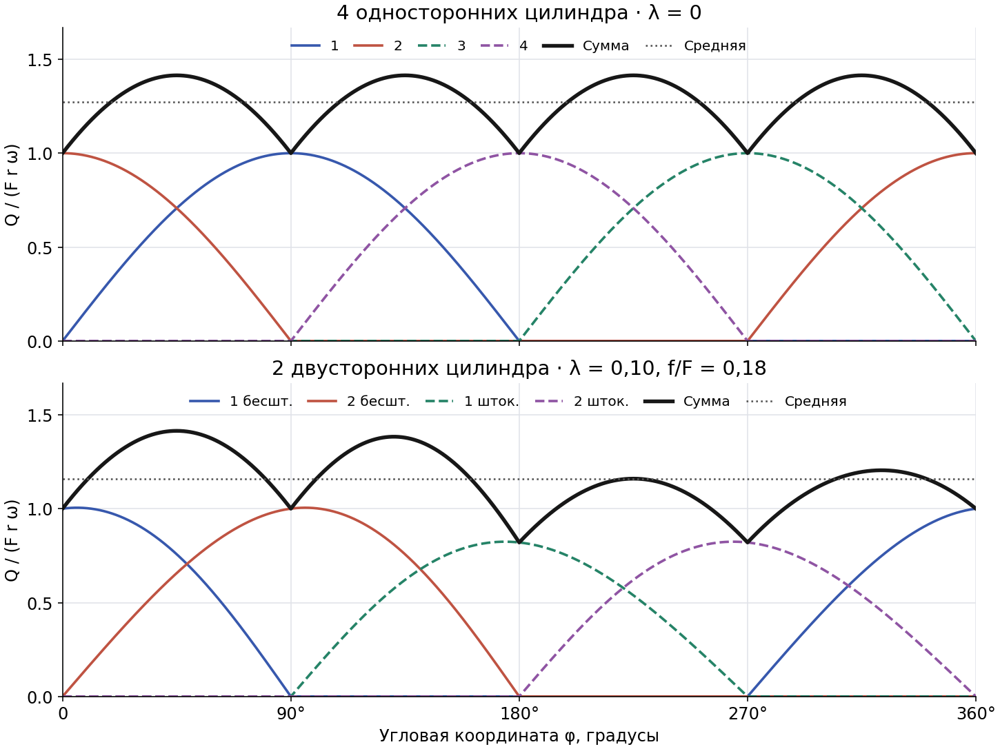
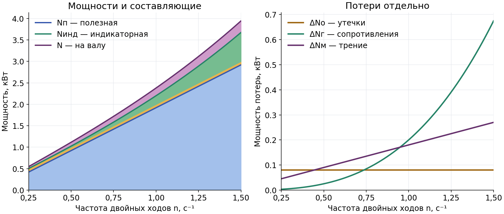

# КР2 — графики подачи, мощности и характеристики

Положение кривой и подписанные оси важнее масштаба учебного эскиза. Номера страниц ниже относятся к PDF. У Башты печатная страница на единицу меньше. Толстые линии на расчётных графиках показывают суммы, тонкие — отдельные составляющие.

## А10 и Б10. Мгновенная подача

| Бланк | Что видно на фото | Учебный аналог и вывод |
|---|---|---|
| А10 | Четыре почти одинаковые вершины с шагом $90^\circ$, четыре перекрывающиеся полуволны подачи камер, уровень $Q_{\mathrm{ср}}$ и штриховка избытка над ним. | Наиболее прямое сопоставление — **четырёхпоршневой насос одностороннего действия**. Форма соответствует строке $z=4$ Т2, рис. 7.1 а. В оригинале Т2 рисунок построен на квадратной сетке при $r/l=0{,}225$, тогда как на бланке отдельно показана штриховка. Два двусторонних цилиндра в предельном случае дают тот же график, см. расчёт ниже. [Т2, стр. 36–38, рис. 7.1 а](../рисунки/Т2/стр037.jpg) |
| Б10 | Четыре максимума между отметками $0,\pi/2,\pi,3\pi/2,2\pi$. Высоты неодинаковы, две первые вершины выше третьей. На фото есть перспектива, цифровые ординаты отсутствуют. | **Двухпоршневой насос двустороннего действия** — наиболее обоснованная интерпретация при одинаковых цилиндрах и равномерном вращении. В Т2, рис. 7.1 в, также показаны неодинаковые вершины двухпоршневого насоса, но там две суммарные кривые для разных втулок, ординаты в л/с и отсутствуют отдельные полуволны. Неравные эффективные площади, фазы, наполнение камер или работа клапанов могут дать разные пики и у других схем. [Т2, стр. 37, рис. 7.1 в](../рисунки/Т2/стр037.jpg) |

Точное издание рисунков бланка остаётся неизвестным. Проверенные аналоги включают Т2, рис. 7.1 а, в, и Башту, рис. 3.4 и 3.9. Башта показывает суммирование подачи одно-, двух- и трёхпоршневых машин и влияние посадки клапанов и сжимаемости. Внешняя проверка ограничена доступом среды. Поисковые сайты Google, Bing, DuckDuckGo и Яндекс, а также Studfile и Studopedia вернули HTTP 403 через прокси. [Башта, PDF 281, рис. 3.4](../рисунки/Башта/стр281.jpg) · [Башта, PDF 288, рис. 3.9](../04_Литература/Башта_Гидравлика_гидромашины_гидроприводы_2010.pdf#page=288)

### Как построить кривые вручную

Примем постоянную угловую скорость $\omega=2\pi n$, несжимаемую жидкость, заполненные камеры, мгновенное переключение клапанов и отсутствие утечек. Пусть $F$ — полная площадь поршня, $f$ — площадь штока, $r$ — радиус кривошипа, $l$ — длина шатуна, $S=2r$ — полный ход, $\lambda=r/l$, $k=f/F$. По кинематике Т2 для местного угла $\theta$ скорость поршня равна $r\omega u(\theta)$, где

$$
u(\theta)=\sin\theta\left(1+\frac{\lambda\cos\theta}{\sqrt{1-\lambda^2\sin^2\theta}}\right).
$$

Запись $[x]_+=\max(x,0)$ оставляет расход только на такте нагнетания.

- Для четырёх одинаковых **односторонних** цилиндров $Q_j=Fr\omega[u(\theta+j\pi/2)]_+$, $j=0,1,2,3$. При переходе на четверть оборота слагаемые циклически переставляются, поэтому четыре участка суммы одинаковы и при конечной длине шатуна. При $\lambda=0$ сумма в единицах $Fr\omega$ равна $|\sin\theta|+|\cos\theta|$. Минимумы равны $1$, максимумы $\sqrt2$, среднее $4/\pi$. Физическое среднее $Q_{\mathrm{ср}}=4FSn$.
- Для двух одинаковых **двусторонних** цилиндров с кривошипами через $90^\circ$ подача каждого цилиндра равна $Fr\omega\{[u(\theta_j)]_++(1-k)[-u(\theta_j)]_+\}$, где $\theta_1=\theta$, $\theta_2=\theta+\pi/2$. Работают четыре камеры, но поршней два. Полные стороны нагнетают с площадью $F$, штоковые — с $F-f$. Физическое среднее $Q_{\mathrm{ср}}=2(2F-f)Sn$. При $k=0$ и $\lambda=0$ сумма и частные полуволны воспроизводят предыдущий случай после выбора начала отсчёта. При $k>0$ уменьшаются полуволны штоковых камер, а при $\lambda>0$ меняются положение и форма максимумов. Одна четверть может объединять две бесштоковые камеры, другая две штоковые, ещё две — разные стороны.

Верхний график удобно перерисовать для А10. На нижнем для Б10 приняты иллюстративные $k=0{,}18$ и $\lambda=0{,}10$, угловая шкала развёрнута относительно $\theta$ по формуле $\theta=\pi/2-\varphi$. Четыре максимума примерно $1{,}414$, $1{,}383$, $1{,}160$, $1{,}204$ в единицах $Fr\omega$. Порядок высот согласуется с фото. Коэффициенты взяты для сравнения форм и не измерены по фото. В Б10 отметки оси в радианах: $0$, $\pi/2$, $\pi$, $3\pi/2$, $2\pi$. Если потребуется физическая размерность, подписать $Q$ в м³/с вместо нормированной ординаты. [Т2, PDF 35–38, §7.2](../01_Лекции/Т2_Гидропередачи_поршневые_роторные_объемные.pdf#page=35)

## А11 и Б11. Баланс мощностей ВПН

Т2 §7.4 и Башта §3.8 дают уравнения баланса. Штатный рисунок баланса по частоте двойных ходов в этих разделах не найден. В Т2, рис. 7.3 б, кривые мощностей привязаны к рабочим точкам **сети** и отложены по подаче $Q$. Поэтому для вопроса о влиянии частоты ниже выбран расчётный эскиз с $n$ по горизонтали. Ожидаемая преподавателем форма графика остаётся неизвестной. [Т2, PDF 44–45, 47–48](../01_Лекции/Т2_Гидропередачи_поршневые_роторные_объемные.pdf#page=44) · [Башта, PDF 291–292, (3.29)–(3.33)](../04_Литература/Башта_Гидравлика_гидромашины_гидроприводы_2010.pdf#page=291)

$$
\begin{aligned}
N_\mathrm{п}&=pQ=\rho gHQ,\\
N_\mathrm{инд}&=n\sum_i A_{\mathrm{инд},i}
=N_\mathrm{п}+\Delta N_\mathrm{о}+\Delta N_\mathrm{г},\\
N&=N_\mathrm{инд}+\Delta N_\mathrm{м}.
\end{aligned}
$$

Здесь $p$ — давление, развиваемое насосом, $H$ — соответствующий напор, $Q$ — действительная средняя подача, $A_{\mathrm{инд},i}$ — индикаторная работа в $i$-й камере за цикл. $\Delta N_\mathrm{о}$ — мощность на прокачивание утечек, $\Delta N_\mathrm{г}$ — гидравлические потери в пределах насоса, прежде всего в клапанах, $\Delta N_\mathrm{м}$ — потери на трение в приводе и уплотнениях. При положительных потерях кривые сверху вниз располагаются как $N>N_\mathrm{инд}>N_\mathrm{п}$. Вертикальный разрыв $N-N_\mathrm{инд}$ показывает механические потери. Разрыв $N_\mathrm{инд}-N_\mathrm{п}$ включает объёмную и гидравлическую составляющие. По одному замеру этих трёх мощностей раздельные значения двух последних составляющих получить нельзя.

**Условия эскиза.** Постоянный перепад давления $p=2$ МПа, рабочий объём $q=1$ л за двойной ход, полное наполнение, установившийся режим, неизменные температура и зазоры. Суммарный расход утечек в примере $0{,}04$ л/с. При $x=n/(1\,\mathrm{с}^{-1})$ полезная мощность составляет $2x-0{,}08$ кВт. Мощности потерь в кВт взяты как $\Delta N_\mathrm{о}=0{,}08$, $\Delta N_\mathrm{г}=0{,}20x^3$, $\Delta N_\mathrm{м}=0{,}18x$. Коэффициенты иллюстрируют форму кривых. Частотный диапазон выбран так, чтобы $Q>0$ и модель имела смысл.

| Слагаемое | Почему зависит от режима |
|---|---|
| Гидравлические потери | При постоянном эффективном проходном сечении и коэффициенте сопротивления перепад $\Delta p_\mathrm{кл}\propto c^2$. При скорости $c\propto n$ и расходе через клапан $\propto n$ получается мощность потерь $\propto n^3$. У действительного клапана меняются подъём и фаза закрытия. Инерционный перепад порядка $n^2$ сам по себе ещё не является потерей энергии. |
| Механические потери | При неизменном моменте трения $M_\mathrm{тр}$ мощность $M_\mathrm{тр}\omega\propto n$. Момент может меняться с нагрузкой, скоростью и смазкой. |
| Объёмные потери | При постоянных перепаде, вязкости и зазорах квазистационарный расход утечек постоянен в этой модели, поэтому $\Delta N_\mathrm{о}=pQ_\mathrm{ут}$ горизонтальна. В реальном насосе меняются перепад и фазы посадки клапанов, так что утечки могут зависеть от частоты косвенно. Неполное наполнение Т2 учитывает отдельно. |
| Полезная мощность | При постоянном $p$ растёт почти линейно с $n$. При работе на сеть с преобладающим квадратичным сопротивлением $H\propto Q^2$ и $Q\propto n$ получается $N_\mathrm{п}\propto n^3$. Это свойство полезной мощности на данной сети. |

Для ответа вручную достаточно расположить сверху $N$, ниже $N_\mathrm{инд}$ и $N_\mathrm{п}$, подписать вертикальные разности и пояснить условия частотных зависимостей. Если ось абсцисс задана в двойных ходах в минуту, подставляйте в формулы частоту $n/60$ в с⁻¹. [Т2, PDF 44–48 и 53–55, (7.15)–(7.16)](../01_Лекции/Т2_Гидропередачи_поршневые_роторные_объемные.pdf#page=53)

## А9, Б9, А13 и Б13. Оригиналы для перерисовки

| Задание | Что рисовать и подписать | Источник |
|---|---|---|
| А9, Б9 | Ось $x$ — перемещение поршня $s$, ось $y$ — давление $p$ в рабочей камере. Контур №3 даёт задержку подъёма давления после мёртвой точки на отрезке $l$, контур №6 — неплотность клапанов, видимую у мёртвой точки на участке $d$. Для сравнения с нормой полезен рис. 6.2. Пики и затухающие колебания около мёртвых точек сами по себе встречаются и в норме. | [Т2, PDF 42, рис. 7.2 а, б](../рисунки/Т2/стр042.jpg) · [Т2, PDF 43–44, пояснения](../01_Лекции/Т2_Гидропередачи_поршневые_роторные_объемные.pdf#page=43) · [Т2, PDF 14, рис. 6.2](../рисунки/Т2/стр014.jpg) |
| А13 | $Q$ по горизонтали, $H$ или $p$ по вертикали. При фиксированном $n$ идеальная линия вертикальна, действительная наклонена к стороне меньшей подачи при увеличении давления. При росте $n$ семейство смещается к большей подаче. Для рабочей точки добавляют характеристику сети. | [Т2, PDF 47–48, рис. 7.3 а, б](../рисунки/Т2/стр047.jpg) |
| Б13 | Давление насоса $p$ по горизонтали, отдельные шкалы подачи, мощности и КПД по вертикали. При фиксированном $n$ провести горизонталь $Q_\mathrm{и}$, ниже неё слегка убывающую $Q$, растущую $N$ с механической нагрузкой даже при малом перепаде и кривую $\eta$, которая быстро поднимается на участке малых давлений, а в показанном диапазоне меняется слабее. За пределами этого диапазона плато КПД не гарантировано. | [Т2, PDF 45, рис. 7.3](../рисунки/Т2/стр045.jpg) |
