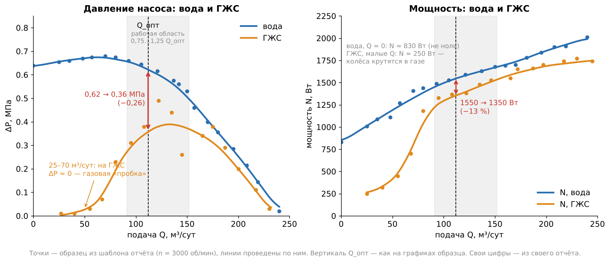
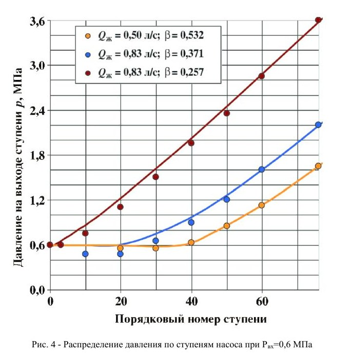
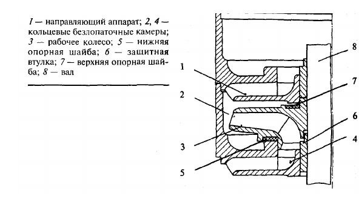

# ЛР2 «Перекачка насосом ГЖС» — дополнение к подготовке

**Как читать.** Это вторая часть. Сначала — основной файл (разделы ①–③ и «Связь с лабой»), потом этот. Здесь — то, о чём преподаватель спрашивает **после** основного ответа: стенд, обработка, графики, устройство насоса и «почему» по кавитации.
**★** — спросят почти наверняка. *(общ.)* — в лекциях и методичках этого нет, ответ из общих знаний.
Числа в примерах — из образца шаблона отчёта (n = 3000 об/мин). **Свои цифры берите из своего отчёта.**

---

## 1. Стенд и порядок работы

**★ Зачем каждый элемент на схеме?**

- **Бак** замыкает контур; газ из смеси в нём всплывает и уходит *(общ.)*.
- **Расходомер** — подача воды.
- **Манометры на входе и выходе** — перепад ΔP.
- **Задвижка на выходе** задаёт режим по подаче.
- **Станция управления** — пуск, частота вращения, потребляемая мощность.
- **Газовая линия:** компрессор → ресивер (гасит пульсации) → дроссель (задаёт расход газа) → газовый счётчик → обратный клапан (не пускает воду к компрессору) → всас насоса.

**★ Почему газ подают после расходомера жидкости?** Расходомер правильно меряет только однофазный поток. Поэтому воду меряют отдельно, газ — своим счётчиком, а смешивают перед самым входом в насос. Значит, Q в расчётах — это расход **жидкости**, а не смеси.

**★ Порядок работы.**

- **Вода.** Залить насос, удалить воздух из импульсных шлангов, пустить при **закрытой** задвижке. Открывать задвижку ступенями от Q = 0 до полного открытия. В каждой точке, когда режим установился, записать Q, P_вх, P_вых, N, n.
- **ГЖС.** Задвижкой выставить подачу (шаг 0,1·Q_опт), дросселем подать газ. Частотой подпорного насоса вернуть P_вх к заданному значению, записать показания. Всё повторить для второго давления на входе.
- **Остановка:** сначала закрыть задвижку, потом выключить двигатель.

**★ Как держали давление на входе постоянным на ГЖС и почему оно «уходит»?** Когда открываем задвижку, растёт подача, растут потери во всасывающей линии, и давление на входе падает. Газ тоже меняет сопротивление подвода. Поэтому после каждого шага давление на входе возвращают частотой подпорного насоса. Постоянным его держат, чтобы газ во всех точках был сжат одинаково и точки можно было сравнивать.

**Почему нельзя долго работать на закрытой задвижке (в методичке — не дольше 5 мин)?** Насос ничего не подаёт, а вся мощность (в образце около 830 Вт) уходит в тепло в малом объёме воды. Греются опоры и уплотнения, при долгой работе вода может закипеть.

**Обороты не ровно 3000 — что делать?** У асинхронного двигателя есть скольжение: реально около 2900 об/мин, и под нагрузкой они немного падают. Для точности все точки приводят к одной частоте по законам подобия (Q ~ n, ΔP ~ n², N ~ n³). Методичка требует приводить к расчётной частоте, если испытывали на пониженной.

**Что моделирует смесь?** «Вода – газ» — модель сильно обводнённой нефти (внешняя фаза — пластовая вода). «Вода – ПАВ – газ» — модель пенистой маловязкой нефти. В пене газ держится мелкими пузырями и вредит меньше.

**Техника безопасности** (если спросят). Перед работой проверить аварийную кнопку, заземление, крепление ступеней и рамы, утечки, свободное вращение вала, положение задвижек. Нельзя работать при утечках, оставлять стенд без оператора, налаживать при включённом двигателе.

---

## 2. Обработка результатов

**★ Посчитайте КПД в одной точке.** Всё в СИ: ΔP в Па, Q в м³/с, N в Вт.
η = 0,62·10⁶ · (121,5 / 86 400) / 1550 = 872 / 1550 ≈ **56 %**.
Если подставить «как есть» (МПа и м³/сут), выйдет абсурд — около 5 %.

**Почему полезная мощность — это ΔP·Q, а не ρgQH?** Это одно и то же: давление p = ρgH. Удобнее брать ΔP, потому что его меряем напрямую.

**★ Зачем в ΔP слагаемое ρgz?** Насос вертикальный, датчики стоят на разной высоте. Чтобы получить полную энергию, которую дал насос, добавляем гидростатику между ними. При z = 1 м ρgz ≈ 9800 Па ≈ 0,01 МПа, то есть 1–2 % от ΔP. Получается в Па — разделить на 10⁶, чтобы сложить с давлениями в МПа.

**Какой КПД мы считаем — насоса или агрегата?** В знаменателе N_потр − N_хх. Если N — электрическая мощность со станции, в ней остаются потери двигателя, растущие с нагрузкой, и КПД получается чуть ниже, чем у самих ступеней *(общ.)*.

**★ Пересчёт газа — на числах.** Счётчик показал 1 м³/ч = 24 м³/сут. Давление на входе 0,1 МПа избыточное → 0,2 МПа абсолютное.

- Газ на входе: 24 · 0,1 / 0,2 = **12 м³/сут** (газ сжат вдвое).
- При Q_в = 120 м³/сут объём смеси = 132 м³/сут.
- β по шаблону = 12/120 = **10 %**; по методичке = 12/132 = **9,1 %**.

Ловушка: если подставить избыточное давление вместо абсолютного, газ завысится — при 0,1 МПа изб вдвое.

**★ Почему β в шаблоне и в методичке разные?** В шаблоне — отношение газа к жидкости, в методичке — доля газа во всей смеси. При малом газе это почти одно и то же, при большом — нет: предел ТУ «25 % по методичке» — это **33 %** по формуле шаблона. В отчёте указать, какое β считали.

**Кривая ГЖС снята при постоянном расходе газа?** Нет: с каждым шагом прибавляли и воду, и газ, чтобы держать β примерно постоянным. Поэтому в отчёте — **среднее** β.

**★ Как нашли Q_опт? Почему у параболы КПД нет свободного члена?** Аппроксимировали КПД параболой y = −0,0036Q² + 0,8749Q и приравняли производную к нулю: Q_опт = 0,8749 / 0,0072 = 121,5 м³/сут. Свободного члена нет, потому что при Q = 0 полезной мощности нет и КПД равен нулю. Второй ноль параболы — 243 м³/сут, там же, где ΔP → 0. Модель осмысленная.

**★ Почему рабочая область 0,75…1,25 Q_опт?** Границы взяты из шаблона, а по смыслу это поле рабочих параметров: по лекциям в нём КПД не более чем на 7 % ниже максимума. Для нашей параболы на краях зоны КПД ≈ 94 % от максимума — укладывается. Левее растут осевая сила, циркуляция, удар потока на входе, правее — скорости и потери. Вне зоны насос изнашивается быстрее.

---

## 3. Графики: что на них и почему

**★ Почему ΔP падает с ростом подачи?** По уравнению Эйлера у лопастей, загнутых назад, теоретический напор линейно уменьшается с подачей. Из этой прямой ещё вычитаются потери: трение растёт примерно как Q², удар на входе растёт при уходе от расчётной подачи. Поэтому реальная кривая идёт ниже и падает всё круче.

**Почему у воды при Q = 0 давление (0,64) меньше максимума (0,68)?** Это характеристика «с горбом», типична для колёс с большим углом лопасти на выходе. Левее максимума одному давлению соответствуют две подачи, и работа может быть неустойчивой. Но эта ветка лежит вне рабочей зоны.

**★ Почему при Q = 0 мощность не ноль (≈ 830 Вт), а дальше растёт?** При закрытой задвижке энергия уходит на трение дисков колёс о воду, на вихри и утечки в зазорах, у ЭЛН — ещё и на трение колёс об опорные шайбы. С ростом подачи добавляется полезная мощность. Значит, мощность минимальна при Q = 0, и центробежный насос пускают на закрытую задвижку. У осевых насосов наоборот: мощность максимальна при Q = 0, их пускают при открытой.

**★ Разберите график вода/ГЖС по зонам** (образец).

- **25–70 м³/сут:** ΔP ≈ 0 — срыв: газ скопился у оси колёс в «пробку», колёса крутятся в газе.
- **80–150:** ΔP сильно ниже воды (при Q_опт 0,36 против 0,62, −42 %) — газовая кавитация.
- **От 170:** кривые почти сходятся — мелкие пузыри уносятся потоком (эмульсия), разница почти только из-за меньшей плотности.

**★ Почему на малых подачах газ вредит сильнее, а на больших — меньше?** На малых скорость жидкости мала: центробежная сила успевает отделить лёгкий газ от тяжёлой воды и согнать его к оси, ко входу колеса. Там пузыри сливаются в каверну. На больших подачах поток быстрый, пузыри дробятся и выносятся раньше, чем успевают собраться *(механизм на больших Q — общ.)*.

**Почему у ГЖС максимум давления при ≈130, а у воды при 60–70?** Правая часть не поднялась — обрушилась левая. На малых подачах газ собирается в пробку, давление там почти нулевое, и максимум остался там, где газ уже выносится потоком.

**Почему на ГЖС при малых подачах мощность (≈250 Вт) даже меньше, чем на воде при закрытой задвижке (830 Вт)?** Колёса крутятся в газовой пробке. Газ почти ничего не весит, трение и перемешивание в нём почти ничего не стоят, жидкость через насос почти не идёт.

**★ Почему давление упало на 42 %, а мощность только на 13 %?** Если бы дело было только в плотности, оба упали бы одинаково (и давление, и мощность пропорциональны плотности). Давление упало гораздо сильнее — значит, каверны ломают передачу энергии, и часть мощности уходит в потери. Поэтому КПД на ГЖС падает: по жидкости при Q_опт 0,36·10⁶ · 0,00141 / 1350 ≈ **37 %** против 56 % на воде.

**Почему точки ГЖС с большим разбросом?** Двухфазный поток нестационарен: пузыри сливаются и рвутся, давление и мощность пульсируют, компрессор подаёт газ неравномерно. Поэтому замер делают только после установления режима.

**★ Что изменило второе давление на входе — на числах.** При том же расходе газа по счётчику (24 м³/сут):

- P_вх = 0,1 МПа изб → 12 м³/сут на входе, β = 10 %;
- P_вх = 0,3 МПа изб → 24·0,1/0,4 = **6 м³/сут**, β = 5 %.

Газ сжат вдвое сильнее, его объёмная доля вдвое меньше. Кривая ГЖС ближе к воде, срыв сдвигается к меньшим подачам и большему газосодержанию.

**★ В каких режимах работа на ГЖС допустима?** Бескавитационный режим при малом газосодержании — допустим. Режим газовой кавитации — нет: падают давление и подача, а в скважине — добыча, растут преждевременные отказы установки.

**★ Как меняется давление по ступеням на ГЖС?** Рисунок: 76 ступеней, давление на входе 0,6 МПа. При β ≈ 26 % (красная) давление растёт почти линейно с первой ступени. При β ≈ 37 % (синяя) первые ~20 ступеней дают плато, а местами давление в них даже **ниже входного**. Дальше газ сжимается и частично растворяется, его доля падает, и ступени начинают работать. Чем больше газа, тем больше «мёртвых» ступеней на входе. *(Оранжевая кривая отличается и подачей, поэтому чистое сравнение — красная и синяя.)*

**Как давление может падать в ступенях насоса?** Ступени в газовой кавитации энергии почти не передают, а гидравлические потери в них остаются. Поток проталкивается через них за счёт давления на входе (подпора), и часть этого давления теряется.

**Почему наша короткая секция чувствует газ сильнее, чем насос в скважине?** Она по сути моделирует только **нижние** ступени настоящего насоса — самую тяжёлую зону. В длинном насосе верхние ступени работают на сжатом газе, и в среднем влияние мягче *(общ.)*.

---

## 4. Насос: как устроен и как работает

*Ступень ЭЛН: 1 — направляющий аппарат, 3 — рабочее колесо, 5 и 7 — нижняя и верхняя опорные шайбы, 8 — вал.*

**★ Как работает ступень? Зачем направляющий аппарат?** Колесо закручивает жидкость, центробежные силы гонят её к периферии, на выходе растут давление и скорость. Направляющий аппарат:
1. как диффузор переводит скорость в давление;
2. снимает закрутку и подводит поток к следующему колесу.

Без него следующее колесо получило бы закрученный поток и дало бы меньший напор.

**★ Что такое плавающее колесо и куда девается осевая сила?** Осевая сила возникает из-за разницы давлений: сзади на колесо давит давление выхода, спереди — меньшее давление входа. Плавающее колесо закреплено на валу только шпонкой от проворота, вдоль вала оно свободно. Каждое колесо опирается через шайбу на бурт направляющего аппарата предыдущей ступени, то есть отдаёт силу на корпус. Силы сотен ступеней не складываются на валу. Минус — трение в шайбах снижает КПД, шайбы изнашиваются.

**При какой подаче осевая сила наибольшая?** На холостом ходу, при Q = 0: давление за колесом высокое, а встречная сила от входящего потока почти нулевая. С ростом подачи сила уменьшается, на больших подачах может сменить знак — колесо поджимается к верхней шайбе *(смена знака — общ.)*. Слева от рабочей зоны колёса сильно трутся о нижние шайбы — ещё одна причина держать насос в рабочей зоне.

**Почему в ЭЛН нет разгрузочного диска или встречных колёс, как в обычных многоступенчатых насосах?** Для встречной схемы нужны переводные каналы, а они не помещаются в корпус диаметром 70–120 мм. Одна гидропята на сотни ступеней принимала бы огромную суммарную силу. Плавающие колёса разгружают каждую ступень отдельно.

**★ Почему КПД ЭЛН всего ~50–56 %, а у больших насосов 80–90 %?** Общий КПД — произведение трёх: гидравлического (трение и вихри в каналах), объёмного (утечки через зазоры с выхода на вход) и механического (подшипники, трение дисков, у ЭЛН — ещё опорные шайбы). У маленькой ступени каналы узкие, относительные зазоры и шероховатость больше — все три КПД ниже.

**★ Насос качает нефть плотностью 850 — что изменится: напор или давление?** Напор в метрах **тот же**: колесо даёт каждому килограмму одинаковую энергию, она зависит только от скоростей. Давление и мощность уменьшатся пропорционально плотности:

- ΔP: 0,62 → ≈ 0,53 МПа (напор при этом те же ≈ 63 м);
- N: ≈ 1550 → ≈ 1320 Вт;
- КПД тот же. Напор снижает **вязкость**, а не плотность.

**★ Снизили частотником обороты с 3000 до 2500 — что будет?** Отношение 0,83.

- подача ~ n: 121,5 → ≈ **101** м³/сут;
- давление ~ n²: 0,62 → ≈ **0,43** МПа;
- мощность ~ n³: 1550 → ≈ **900** Вт;
- КПД практически тот же.

**Убрали половину ступеней — что с характеристикой?** Ступени включены последовательно: подача одна, давления складываются. ΔP при каждой подаче уменьшится вдвое, мощность тоже примерно вдвое. Q_опт и КПД не изменятся — подачу задают размеры ступени и частота.

**Как поднять напор ступени, если диаметр ограничен скважиной?** Напор растёт как квадрат окружной скорости (диаметр × обороты). Если диаметр нельзя увеличить, поднимают обороты (высокооборотные установки) *(общ.)*, остальное добирают числом ступеней.

**Коэффициент быстроходности для ЭЛН?** Считают для **одной ступени** — подставляют напор ступени, а не всего насоса. Для ЭЛН выходит около 100–150 *(оценка, общ.)* — нормальное центробежное колесо. Отсюда вид наших кривых: давление падает с подачей, мощность растёт, пуск при закрытой задвижке правильный.

**★ Что такое рабочая точка? Как вы меняли режим?** Рабочая точка — пересечение характеристики насоса с характеристикой сети. Прикрывая задвижку, мы делали сеть «круче», и точка уходила влево. Это дросселирование: просто, но неэкономично — часть напора сгорает в задвижке, и подачу можно только уменьшить. Частотой подачу меняют в обе стороны без потерь на дросселирование — поэтому у УЭЦН станции с частотным преобразователем *(общ.)*. В скважине «сеть» — подъём жидкости от динамического уровня до устья плюс потери в трубах *(общ.)*.

**Что будет на вязкой нефти?** Растут трение в каналах и трение дисков, поэтому подача, напор и КПД падают, а мощность растёт. Пересчитывают по опытным коэффициентам (как в ДЗ-1).

---

## 5. Кавитация глубже — уточняющие вопросы

**★ Почему давление минимально у входной кромки, а не на выходе, где скорость больше?** На выходе колесо уже отдало жидкости энергию, давление там высокое. На входе колесо ещё ничего не добавило, а жидкость уже потратила давление на разгон и потери в подводе. Сверху — ещё провал при обтекании носика лопасти. Минимум — сразу за входной кромкой, там, где местная скорость обтекания наибольшая (в методичке — «на выпуклой части лопатки»).

**★ Кавитация начинается, когда напор упал на 3 %?** **Нет.** Пузыри и короткие каверны появляются раньше, ещё на «полке» графика: пока каверна короткая, напор не меняется. 3 % — удобный для измерения условный критерий, а не начало кавитации. Поэтому эрозия возможна и на полке, и поэтому берут допускаемый запас больше критического.

**★ Изменится ли допускаемый запас на горячей воде? А в горах?** Почти нет. Запас — свойство насоса: он определяется скоростями на входе (конструкция, обороты, подача). Меняется **допустимая высота всасывания**: у горячей воды больше давление пара, в горах меньше атмосферное давление. В обоих случаях насос надо ставить ниже, а требование насоса прежнее.

**★ С какой глубины насос может всасывать холодную воду? Поставим мощнее — возьмёт глубже?** Насос не «тянет» воду — её вдавливает атмосферное давление. Предел — около 10 м водяного столба. Минус давление пара, запас насоса и потери — на практике остаётся около 5–7 м *(общ.)*. Мощность не поможет: она даёт давление на **выходе**, а всасывание ограничено давлением на **входе**.

**Почему воду ~100 °C из открытого бака насос не всасывает?** При 100 °C давление пара равно атмосферному — нечему «вдавливать» воду в насос. Бак ставят **выше** насоса на запас плюс потери (так стоит насос под деаэратором).

**★ Подняли обороты вдвое — что с кавитацией?** Требуемый запас растёт как квадрат оборотов — **вчетверо**. Было нужно 3 м, станет 12 м. Насос почти наверняка закавитирует. Обороты насоса ограничивает в первую очередь кавитация.

**★ Почему при снятии кавитационной характеристики давление снижают вакуум-насосом в баке, а не прикрывают задвижку на всасе?** Вакуум-насос меняет только давление, а скорости и углы потока на входе в колесо остаются прежними — меряем ровно то, что нужно. Задвижка на всасе испортила бы поток на входе и могла бы кавитировать сама. Подачу держат постоянной задвижкой на выходе, потому что требуемый запас сильно зависит от подачи.

**★ Почему с ростом подачи нужен больший запас?** Больше подача — больше скорости перед лопастью, глубже провал давления. По графику из лекций: при подаче 45, 70 и 90 л/с срыв наступает при запасе ≈ 2,5, 3,5 и 5 м. Поэтому кавитационные характеристики снимают на минимальной, номинальной и максимальной подачах.

**Почему шнеку кавитация не так страшна?** У него длинные винтовые лопасти с малыми углами. Каверна на входе занимает лишь часть длинного канала, и шнек продолжает повышать давление. Его делают из кавитационно-стойких материалов. А главное — он создаёт подпор для центробежного колеса.

**Сделаем вход колеса огромным — кавитации не будет?** До предела. Шире вход — меньше скорость входа, но на большом диаметре растёт окружная скорость, и относительная скорость у кромки снова растёт. Плюс падает КПД. Выгоднее расширять колесо по ширине на входе.

**Почему в многоступенчатом насосе срыв считают по напору первой ступени?** Сильнее всего кавитирует первое колесо — на входе в него давление наименьшее. У ЭЛН сотни ступеней по 3–7 м: 2–3 % от напора всего насоса больше напора одной ступени. Такое падение заметили бы, только когда первая ступень почти полностью сорвалась. Поэтому критерий — 2 % напора первой ступени.

**Почему коэффициент запаса A не один для всех (1,1…1,4)?** Чем меньше сам критический запас в метрах, тем больший коэффициент: малый запас «съедается» даже малой ошибкой или колебанием режима. Для агрессивных жидкостей и морской воды A выше — эрозия сильнее.

**Как оператор поймёт, что насос близок к кавитации, не разбирая его?** По вакуумметру на входе: если вакуум больше допустимого, запаса не хватает. Плюс треск, вибрация, скачущие давление и подача.

**★ Почему в ЭЛН паровая кавитация — редкость, а газ — главная проблема?** Давление на приёме создаёт столб жидкости над насосом — обычно десятки атмосфер, намного выше давления пара. Но часто ниже **давления насыщения нефти газом**: растворённый газ выделяется, и начинается газовая кавитация *(связь с давлением насыщения — общ.)*.

**Ловушка «Кипит во входном патрубке».** Нет: во входном патрубке давление ещё выше давления пара на величину запаса. Кипит дальше — у входной кромки лопасти. Запас меряют на входе, а кавитирует внутри.

---

## 6. Если спросят по отчёту — неточности шаблона

- **КПД:** формула без единиц. Подставлять ΔP в Па, Q в м³/с.
- **Газ:** в п. 5–6 шаблона стоит V_г, а подставлять надо уже пересчитанный к давлению входа V_г^вс (м³/сут — расход счётчика в м³/ч × 24).
- **Образец сам себе противоречит:** парабола даёт максимум КПД 53 %, а в тексте 56 %; на стр. 6 N_опт = 1580 Вт и ΔP = 0,6 МПа, на графиках стр. 8–9 — 1550 Вт и 0,62 МПа; вертикаль Q_опт на графиках стоит около 112, а не 121,5. В своём отчёте все «оптимальные» значения брать при **своём** Q_опт.
- **На комплексной характеристике шаблона** КПД нанесён на ось мощности (0–2500) и не читается — лучше отдельная ось.
