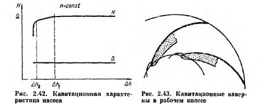
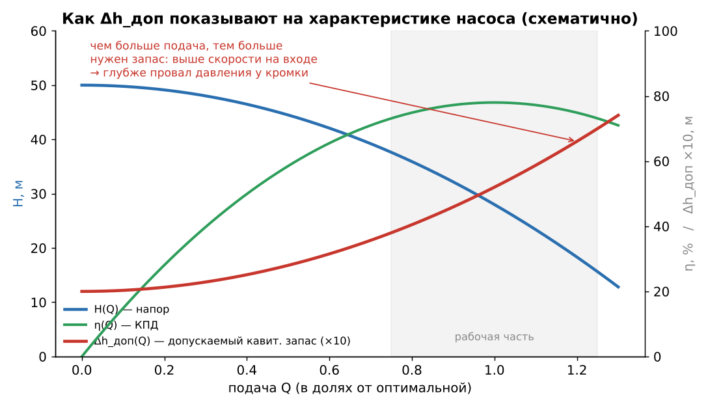
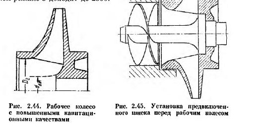
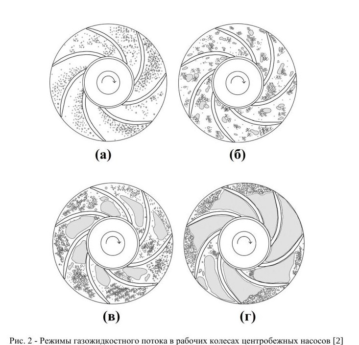
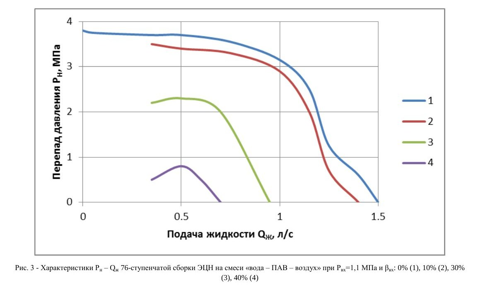
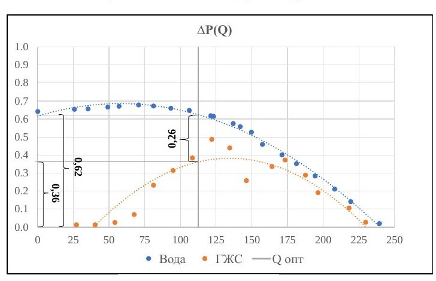

# ЛР №2 «Перекачка насосом ГЖС» — подготовка к устной защите

**Для чего:** устная защита у Долова Т.Р. Он **не требует формул и заученных определений**, ему важно **понимание процесса**, и он любит **вопросы по самой работе**. Поэтому ниже всё объяснено «своими словами»: что говорить и почему это так.
**Вопросы, надиктованные на лабе:** ① Что такое кавитация и чем она вредит. ② Что такое допускаемый кавитационный запас, как его найти. ③ Методы борьбы с кавитацией.
**Опора — лекции и учебник** (их и называть на защите): Касьянов и др., Тетрадь I, §2.20 «Кавитация в центробежных насосах» (Т1, стр. 73–79); Башта, гл. 14, §2.19–2.20 (стр. 201–209). Методички: ЛР2-М (Ивановский, Долов, Шайхулов — ЭЛН на ГЖС), ЛР2-К (кавитационная характеристика), шаблон отчёта ЛР2-Ш.
**Как читать:** блоки **«🗣 Скажи так»** — готовая устная формулировка (её не зубрить, а пересказать своими словами). Дальше — объяснение, чтобы ответить на уточняющие вопросы. ⭐ — главное. *(общ.)* — из общих знаний, в наших материалах этого нет.

---

## 0. Шпаргалка за 2 минуты (прочитать перед входом)

1. **Кавитация** — это когда в потоке давление падает до давления насыщенного пара, жидкость **вскипает** при обычной температуре, а потом пузырьки пара попадают в зону высокого давления и **схлопываются**. Каждое схлопывание — это микроудар о стенку. В насосе это происходит **у входной кромки лопасти рабочего колеса**: там самое низкое давление.
2. **Вред:** эрозия металла (питтинг); шум, треск и вибрация; падение напора, подачи, мощности и КПД, вплоть до **срыва** работы насоса.
3. **Кавитационный запас Δh** — насколько энергия жидкости на входе в насос больше давления насыщенного пара. Это «подушка», которую насос сам «съедает» на разгон потока у лопасти.
4. **Критический запас** находят опытом по **кавитационной характеристике**: держат Q и n постоянными и понижают давление на входе. Тот запас, при котором напор упал на **3 %**, и есть критический. **Допускаемый = критический × A**, где A = 1,1…1,4.
5. **Борьба:** дать насосу больше давления на входе (опустить насос, поставить его под залив, подпорный насос, короткая и широкая всасывающая линия, холодная жидкость, не дросселировать на всасе, работать в расчётном режиме), а насосу — меньшую потребность в запасе (шире вход колеса, тонкие кромки, двусторонний вход, **предвключённый шнек**, стойкие материалы).
6. **Наша работа:** через ЭЛН качали воду, а потом воду с воздухом. Газ создаёт **искусственную (газовую) кавитацию**: газовые каверны забивают каналы, и падают ΔP, подача и мощность. Эрозии при этом нет, потому что газ не схлопывается. Чем больше газа и чем ниже давление на входе, тем хуже.

---

## 1. Что за работа — уметь рассказать за минуту

**🗣 Скажи так:** «Мы исследовали, как свободный газ влияет на характеристику скважинного электроприводного лопастного насоса (ЭЛН). Сначала сняли характеристику на чистой воде: подачу, давления на входе и выходе, потребляемую мощность. Построили комплексную характеристику и нашли оптимальную подачу по максимуму КПД. Потом от компрессора подавали воздух во всасывающую линию и снимали те же величины на газожидкостной смеси при постоянном давлении на входе. Это давление держал подпорный насос. Опыт повторили для двух давлений на входе. В итоге увидели, что газ снижает развиваемое давление и мощность и что при большем давлении на входе насос переносит газ лучше».

*Стенд (ЛР2-Ш, стр. 2): бак → подпорный насос → расходомер → испытываемый насос (вертикальная секция ступеней с асинхронным двигателем и станцией управления) → манометр, задвижка → обратно в бак. В установке №2 добавлены компрессор, задвижка и газовый счётчик (расход газа он показывает при нормальных условиях).*

**Зачем каждый элемент (это любят спрашивать):**

| Элемент | Зачем |
|---|---|
| **Подпорный насос** | Создаёт и держит **постоянное давление на входе** испытываемого насоса. Его меняют частотой вращения через станцию управления. В скважине этому соответствует погружение насоса под динамический уровень (ЛР2-М, стр. 29) |
| **Задвижка на выходе** | Задаёт режим по подаче (шаг 0,1 Q_опт). Пуск и остановка — при закрытой задвижке |
| **Расходомер** | Подача жидкости, л/мин (пересчитываем в м³/сут: × 1,44) |
| **Манометры на входе и выходе** | Перепад давлений ΔP = P_вых − P_вх (+ρgz, поправка на высоту датчиков) |
| **Станция управления** | Частота вращения (n = 3000 об/мин) и потребляемая мощность N_потр |
| **Компрессор и газовый счётчик** | Подача воздуха, по счётчику — при атмосферных условиях. Пересчитываем на давление входа по закону Бойля–Мариотта |
| **Мощность холостого хода N_хх** | Её меряют на сборке **без рабочих колёс**, это потери в подшипниках и сальниках. Вычитаем, чтобы осталась мощность, которая реально ушла в ступени (ЛР2-М, стр. 28) |

**Почему насос многоступенчатый (частый вопрос):** диаметр колеса ограничен обсадной колонной скважины, поэтому одна ступень даёт всего 3–7 м напора. Нужный напор набирают числом ступеней, их бывает до 550 (ЛР2-М, стр. 4–6). Колёса **плавающие**: они не закреплены на валу в осевом направлении, это упрощает сборку и разгружает вал от осевой силы.

> **Свои цифры знай наизусть:** Q_опт, ΔP_опт, N_опт, η_опт на воде; среднее газосодержание β; два давления на входе; насколько упали ΔP и N при Q_опт. В образце шаблона: Q_опт = 121,5 м³/сут, ΔP = 0,6 МПа, N = 1580 Вт, η = 56 %; на ГЖС при Q_опт ΔP упало с 0,62 до 0,36 МПа, N — с 1550 до 1350 Вт.

---

## 2. ⭐ Вопрос ①. Что такое кавитация и чем она вредит

**🗣 Скажи так:** «Кавитация — это вскипание жидкости в зоне пониженного давления и последующая конденсация паровых пузырьков, когда их выносит в зону повышенного давления (Т1, стр. 74). Жидкость кипит не от нагрева, а потому, что давление упало до давления насыщенного пара при данной температуре. В центробежном насосе самое низкое давление — у входа в межлопастные каналы, у входной кромки лопасти: там поток разгоняется при обтекании, и относительная скорость максимальна. Пузырьки рождаются там, сносятся потоком дальше по колесу, где давление уже высокое, и там мгновенно схлопываются. Жидкость с разгона бьёт в точку схлопывания, получается точечный гидроудар. Если это происходит на стенке, металл выкрашивается».

*Ключевая картинка. Давление от входа в насос сначала **падает** (потери в подводе и разгон потока на лопасти, точка B), а потом колесо его поднимает. Если давление на входе понизить (красная линия), провал в точке B уходит ниже давления пара, и там начинается кипение. Аналог — рис. 4.1 в ЛР2-К.*

**Почему пузырёк бьёт так сильно.** Внутри пузырька давление пара маленькое и постоянное, а снаружи давление растёт. Жидкость ускоренно летит к центру пузырька и при смыкании практически несжимаема, поэтому получается резкий точечный удар. Давления в точках смыкания достигают **нескольких мегапаскалей** (Т1, стр. 74), по Баште — до **сотен мегапаскалей** местно (стр. 202). Удары идут с высокой частотой, тысячи раз в секунду *(общ.)*. Кроме механики есть ещё **термические и электрохимические** процессы, они ускоряют разрушение (Т1, стр. 74).

**⭐ Чем вредит — 4 пункта (Т1, стр. 74–75; Башта, стр. 202):**

1. **Эрозия (питтинг)** — местное разрушение металла лопастей и подвода. Это **самое опасное следствие**. На чугуне получается губчатая структура с глубокими щелями, на стали — гладкие «проточенные» канавки. **Абсолютно стойких материалов нет.** Хуже всего держатся хрупкие неоднородные материалы (чугун, керамика), лучше всего — легированные стали с никелем и хромом.
2. **Шум, треск, вибрация**, а при развитой кавитации — **удары** в проточной части. Вибрация разбивает подшипники и уплотнения *(общ.)*.
3. **Падение напора, подачи, мощности и КПД.** На лопасти образуется **каверна**, то есть полость с паром (рисунок ниже). Она стесняет канал и портит обтекание лопасти, поэтому колесо хуже передаёт энергию жидкости.
4. **Срыв работы насоса** — при развитой кавитации напор резко обрушивается, насос перестаёт качать.

*Башта, рис. 2.43 (справа): каверны на тыльной стороне лопастей у входных кромок. Чем меньше запас, тем длиннее каверна. Когда она дотягивается почти до выхода из колеса, напор падает.*

**Три стадии (Т1, стр. 75)** — хорошо звучит на защите:

- **Начальная** — в зоне кавитации смесь жидкости и пузырьков. Нежелательна, но допустима, если детали из кавитационно-стойких материалов.
- **Развитая** — на поверхности образуются крупные каверны, они срываются потоком и образуются вновь. **Недопустима.**
- **Суперкавитация** — весь обтекаемый элемент (лопасть) находится внутри каверны. **Недопустима.**

**Если спросят «как понять, что насос кавитирует»:** по звуку (треск, будто внутри перекатывается гравий *(общ.)*), по вибрации, по падению и колебаниям давления на выходе и подачи, по вакуумметру на входе. После разборки видна изъеденная поверхность лопастей у входа.

**Если спросят «где ещё бывает кавитация»:** не только на входе в колесо, но и в напорных потоках, где поток срывается с лопастей, направляющих лопаток и регулирующих органов (Т1, стр. 75). Вне насосов — на гребных винтах, в клапанах и дросселях *(общ.)*.

**Если спросят «почему первое колесо»:** в многоступенчатом насосе кавитации больше всего подвержено **первое по ходу колесо**: давление на входе в него наименьшее, а следующие колёса получают жидкость уже под давлением (Т1, стр. 75).

---

## 3. ⭐ Вопрос ②. Допускаемый кавитационный запас — что это и как его найти

### 3.1. Сначала — что такое кавитационный запас Δh

**🗣 Скажи так:** «Кавитационный запас — это превышение полного напора жидкости во входном патрубке насоса над давлением её насыщенного пара (Башта, стр. 202). То есть насколько на входе у нас энергии больше, чем нужно, чтобы жидкость не закипела. Внутри насоса до точки минимального давления часть этой энергии теряется: на сопротивление подвода и на разгон потока у лопасти. Если запаса не хватает покрыть этот провал, в точке минимума давление дойдёт до давления пара и начнётся кавитация. Поэтому запас — это мера защищённости насоса от кавитации».

В словах формула выглядит так: **запас = (давление на входе + скоростной напор на входе − давление пара), выраженное в метрах столба жидкости.** Если спросят формулу, вот она (Башта ф. 2.64):

$$\Delta h = \frac{p_{вх}}{\rho g} + \frac{v_{вх}^2}{2g} - \frac{p_{нп}}{\rho g}$$

Международное название — **NPSH** (Net Positive Suction Head) *(общ.)*. Его полезно один раз упомянуть: звучит как от человека, который в теме.

**Два «запаса» — важно не путать** *(общ., но вытекает из Т1 и Башты)*:

- **имеющийся (располагаемый)** — его даёт **установка**: уровень жидкости, давление в баке, потери во всасывающей линии, температура;
- **требуемый (Δh_кр, Δh_доп)** — его требует **насос**, он зависит от конструкции входа колеса и режима работы.
Насос работает без кавитации, пока **имеющийся ≥ допускаемого**.

*Пример, как складывается имеющийся запас. Атмосферное давление (~10,3 м вод. ст.) «тратится» на подъём жидкости до насоса и на потери во всасывающей линии, а давление пара «отнимает» ещё. С горячей водой давление пара почти 5 м, и запаса не остаётся. Поэтому горячую воду подают насосы, установленные **ниже** ёмкости (Т1, стр. 78–79).*

### 3.2. Критический и допускаемый запас

**🗣 Скажи так:** «Критический кавитационный запас — это запас, при котором начинается кавитация, заметная по характеристике. По стандарту за него принимают запас, при котором напор на частной кавитационной характеристике падает на 3 % (ЛР2-К, стр. 2). Работать на критическом нельзя: насос уже в начальной стадии кавитации (Т1, стр. 78). Поэтому вводят допускаемый запас — критический, умноженный на коэффициент запаса A = 1,1…1,4. Это 10–40 % «на всякий случай»: на неточность опыта, на износ, на колебания режима».

- **Δh_доп = A · Δh_кр**, A = 1,1…1,3 (Башта, стр. 204) или 1,1…1,4 (ЛР2-М, стр. 11). По лекциям — запас около **25 %** (Т1, стр. 78).
- По ЛР2-К A = a·K_δ·K_ж и берётся по графикам. **Чем меньше сам Δh_кр, тем больший относительный запас** (a до 1,3). Для агрессивных жидкостей и морской воды запас больше, для горячей воды выше 100 °C — меньше.
- Δh_доп **наносят на паспортную характеристику насоса** кривой Δh_доп(Q). По ней проектировщик решает, на какой высоте ставить насос.

### 3.3. ⭐ Как его найти — три способа (Башта, стр. 208–209)

**Способ 1 — опытом, по кавитационной характеристике. Главный, про него и рассказывать.**

**🗣 Скажи так:** «Насос испытывают на закрытом стенде: герметичный бак, к нему подключён вакуум-насос (ЛР2-К, стр. 5). Задвижкой выставляют нужную подачу, частота вращения постоянная. Затем вакуум-насосом ступенчато понижают давление над жидкостью в баке, то есть уменьшают кавитационный запас на входе. Чтобы подача не менялась, её всё время подправляют задвижкой. В каждой точке записывают подачу, давления на входе и выходе, частоту и температуру. Строят зависимость напора от запаса. Пока запас большой, напор от него не зависит, на графике горизонтальная полка. Потом напор начинает падать и резко обрывается, это срыв. Проводим линию на 3 % ниже полки, её пересечение с кривой даёт критический запас. Умножаем на коэффициент запаса и получаем допускаемый».

Детали, которые показывают, что ты разбираешься:

- Почему **Q и n держат постоянными**: иначе напор менялся бы и от режима, и было бы непонятно, где падение из-за кавитации.
- Почему у срыва **шаг мелкий** (не более 25 мм рт. ст.): кривая обрывается круто, крупным шагом критическую точку проскочишь. По ГОСТ точек ≥ 16, из них ≥ 8 — от начала кавитации до срыва (ЛР2-К, стр. 6).
- Характеристику снимают **на минимальной, номинальной и максимальной подачах** рабочего интервала: запас нужен разный (ЛР2-К, стр. 2). В лекциях есть пример (Т2, стр. 98, рис. 9.17): при Q = 45, 70 и 90 л/с срыв наступает при Δh ≈ 2,5, 3,5 и 5 м.
- **Критерий в лекциях другой:** в Т2 (стр. 97, по старому ГОСТ 6134-71) критический запас — это падение напора на **2 %** первой ступени (или на 1 м, если напор ступени больше 50 м). В методичке (ГОСТ 6134-2007) — **3 %**. Если спросят, назови оба: это покажет, что ты читал лекции, а не только методичку.
- У Башты различают **первый критический режим** (напор только начал падать) и **второй** (резкий обрыв, каверна теряет устойчивость). У многих тихоходных насосов первый вообще не виден (стр. 203–204).
- Как считают запас по приборам: барометрическое давление + показание мановакуумметра на входе − давление пара. Всё переводят в метры столба, добавляют отметку прибора и скоростной напор (ЛР2-К, ф. 4.1; та же формула в лекциях — Т2, стр. 100). Давление пара берут по таблице **по температуре жидкости**, поэтому температуру и меряют.

**Способ 2 — пересчётом с подобного насоса или другой частоты.** Критический запас пропорционален квадрату скорости, то есть **Δh_кр ~ (n·D)²** (Башта ф. 2.72; ЛР2-К ф. 4.2). Увеличил обороты в 1,5 раза — запас нужен в 2,25 раза больше. Кавитационные качества зависят **только от входа в колесо**, выход на них почти не влияет (Башта, стр. 207–208).

**Способ 3 — по кавитационному коэффициенту быстроходности Руднева C** (Т1, стр. 77; Башта, стр. 208). Это число одинаково для подобных насосов на подобных режимах. Зная C, по n и Q находят Δh_кр. **Чем больше C, тем лучше кавитационные качества:** обычные насосы — 800…1000; плохие (для грязных жидкостей) — 600…700; улучшенные — 1300 и более; со шнеком — до 5000. В лекциях для начальной стадии — 900…1500.

### 3.4. Зачем он нужен на практике

**🗣 Скажи так:** «По допускаемому запасу определяют **допустимую высоту всасывания**: насколько высоко над уровнем жидкости можно поставить насос, или, наоборот, какой нужен подпор. Это и есть основная мера против кавитации — соблюдать такую высоту всасывания, при которой кавитация не возникает (Т1, стр. 76)».

*Требуемый запас растёт с подачей: больше скорость на входе — глубже провал давления у кромки. Поэтому насос, загнанный на подачу больше расчётной (например, при сброшенном давлении в сети), может закавитировать там, где на номинале работал нормально. Рисунок схематичный; подтверждение в лекциях — Т2, рис. 9.17 (стр. 98): чем больше подача, тем больше критический запас.*

Как Δh_доп зависит от условий:

- **Температура ↑** → давление пара ↑ → имеющийся запас ↓ → насос надо ставить ниже. При какой-то температуре допустимая высота всасывания становится нулевой, и насос ставят **под залив** (Т1, стр. 78–79).
- **Частота вращения ↑** → требуемый запас ↑ квадратично (Т1, стр. 78: «существенное влияние частоты вращения»).
- **Давление в приёмной ёмкости ↑** → допустимая высота ↑ (Т1, стр. 79). Наш подпорный насос делает именно это.

---

## 4. ⭐ Вопрос ③. Методы борьбы с кавитацией

**🗣 Скажи так:** «Методы делятся на две группы. Первая — увеличить давление, которое установка подаёт на вход насоса, то есть имеющийся кавитационный запас. Вторая — уменьшить запас, который требуется самому насосу, это конструктивные меры. И отдельно — сделать так, чтобы кавитация, если она всё-таки есть, меньше разрушала насос: стойкие материалы».

### 4.1. Эксплуатационные и монтажные меры (увеличить имеющийся запас)

| Мера | Почему работает | Источник |
|---|---|---|
| **Соблюдать допустимую высоту всасывания**: насос пониже, при горячей жидкости — **под залив** | Меньше подъём — больше давление на входе | Т1, стр. 76, 79 |
| **Уменьшить потери во всасывающей линии**: больше диаметр, короче, меньше колен и местных сопротивлений, чистый фильтр/сетка | Потери «съедают» запас | Т1, стр. 78; Башта ф. 2.63 |
| **Не регулировать подачу дросселем на всасывающей трубе** — только на напорной | Дроссель на всасе снижает давление на входе и вызывает кавитацию | Т1, стр. 56 ⭐ |
| **Повысить давление в приёмной ёмкости**: подпорный (бустерный) насос, наддув бака | Прямо поднимает давление на входе | Т1, стр. 79; Башта, стр. 203 |
| **Понизить температуру** жидкости | Ниже давление насыщенного пара | Т1, стр. 78 |
| **Работать вблизи расчётного режима**, не уходить на завышенные подачи | Требуемый запас растёт с подачей; на нерасчётных режимах — удар потока о кромку и срыв | Т1, стр. 75 |
| **Снизить частоту вращения** | Требуемый запас ~ n² | Башта ф. 2.72 |
| Для ЭЛН — **больше погружение** насоса под динамический уровень | Больше давление на приёме | ЛР2-М *(общ. для скважин)* |

### 4.2. Конструктивные меры (уменьшить требуемый запас)

| Мера | Почему работает | Источник |
|---|---|---|
| **Увеличить диаметр входа и ширину колеса на входе** | Меньше скорость на входе — меньше провал давления. Ширина особенно эффективна и мало снижает КПД; слишком большой диаметр входа снижает КПД | Башта, стр. 209 |
| **Тонкие, хорошо спрофилированные входные кромки** лопастей, рациональная форма проточной части | Меньше местный разгон потока у кромки | Т1, стр. 75; Башта, стр. 209 |
| **Ограничить скорости** в проточной части | Скорость — причина провала давления | Т1, стр. 75 |
| **Осесимметричный подвод** (конфузор, спиральный подвод) | Без перекосов потока нет больших углов атаки и местных срывов | Башта, стр. 210–211 |
| **Колесо двустороннего входа** | Каждая сторона пропускает половину подачи, и при том же запасе можно в √2 раза поднять обороты | Т1, стр. 78; Башта, стр. 208 |
| ⭐ **Предвключённый шнек / осевое колесо** перед первой ступенью | Шнек сам хорошо переносит кавитацию и поднимает давление на входе в центробежное колесо. C — до 5000 | Т1, стр. 75; Башта, стр. 209 |

*Башта, рис. 2.44 — колесо с повышенными кавитационными качествами (широкий вход), рис. 2.45 — предвключённый шнек перед рабочим колесом.*

### 4.3. Меры «если кавитации не избежать»

- **Кавитационно-стойкие материалы**: легированные стали с Ni и Cr, а не чугун (Т1, стр. 74). Шнеки делают из стойких материалов (Т1, стр. 75).
- Защитные покрытия, наплавка изношенных мест *(общ.)*.
- Подвод небольшого количества воздуха в зону кавитации смягчает удары: газ демпфирует схлопывание *(общ.)*. Ниже видно, что газ не схлопывается, это та же физика.

---

## 5. ⭐ Связь кавитации с нашей работой (ГЖС) — сюда он почти наверняка спросит

**🗣 Скажи так:** «На нашем стенде паровой кавитации не было: вода холодная, на входе подпор от подпорного насоса. Но когда мы подавали газ, насос работал в режиме **искусственной (газовой) кавитации** (ЛР2-М, стр. 14–15). Пока газа мало, он в виде мелких пузырьков равномерно перемешан с жидкостью, это эмульсия, и характеристика почти как на воде, чуть ниже за счёт меньшей плотности. С ростом газосодержания пузырьки сливаются в газовые каверны. Они сидят в каналах колеса и направляющего аппарата и не участвуют в течении. Сечение каналов уменьшается, обтекание лопастей нарушается, насос хуже передаёт энергию. Давление и подача падают, а при большом газосодержании происходит срыв подачи. Это гидродинамически подобно паровой кавитации. Разница в том, что газовые пузыри при росте давления не схлопываются, а только сжимаются, поэтому эрозии нет».

*ЛР2-М, рис. 2: (а) мелкие пузырьки — эмульсия; (б) пузыри крупнее; (в) газовые каверны у лопастей; (г) каверны занимают большую часть каналов — близко к срыву.*

*По рис. 6 ЛР2-М: до нескольких процентов газа насос почти не чувствует. Дальше давление и подача падают круто, к 25 % насос практически не создаёт давления. Отсюда требование ТУ: свободного газа на приёме ЭЛН не более 25 % (ЛР2-М, стр. 5).*

*ЛР2-М, рис. 3: 76 ступеней, P_вх = 1,1 МПа, β = 0, 10, 30, 40 %. При 10 % кривая чуть ниже воды (меньше плотность). При 30–40 % — резкое падение, справа кривая почти вертикальная, слева (малые подачи) загибается вниз.*

*Образец из шаблона отчёта: при Q_опт ΔP упало с 0,62 до 0,36 МПа. На малых подачах (25–60 м³/сут) насос на ГЖС почти не создаёт давления.*

**Факторы, от которых зависит влияние газа (ЛР2-М, стр. 15):** газосодержание на входе β; **абсолютное давление на входе**; пенообразующие свойства и вязкость жидкости; число ступеней; режим по подаче.

**Как меняется давление по длине насоса (ЛР2-М, стр. 19–21)** — эффектный вопрос:

*Первые ступени при большом газосодержании не создают давления или даже работают как гидравлическое сопротивление. По мере роста давления газ сжимается и частично растворяется, β падает, и дальше ступени начинают работать. Чем больше газа, тем больше «мёртвых» ступеней на входе (оранжевая кривая — около 35–40 из 76).*

---

## 6. Вероятные вопросы по работе — короткие ответы

**Почему при газе падает ΔP?** Две причины. ① Плотность смеси меньше, а давление, которое создаёт колесо, пропорционально плотности (напор в метрах тот же, а давление меньше). Это работает при малом β. ② При большом β образуются газовые каверны: каналы забиты, обтекание сорвано — это искусственная кавитация.

**Почему падает мощность?** Насос перекачивает меньшую массу: плотность меньше, часть объёма занимает газ. По подобию N ~ ρ. Колесо, крутящееся «в газе», почти не нагружено. Если спросят, это как насос, работающий всухую *(общ.)*.

**Почему на малых подачах газ вредит сильнее?** Скорости малые, поток не успевает выносить газ. Центробежная сила отбрасывает тяжёлую жидкость к периферии, а лёгкий газ — к оси, ко входу колеса. Газ там скапливается в каверну или «газовую пробку» (ЛР2-М, стр. 17–19; Башта, стр. 202).

**Зачем газ пересчитывать к условиям входа?** Счётчик показывает объём при атмосферном давлении. На входе давление выше, и газ сжат (Бойль–Мариотт при постоянной температуре): объём при давлении входа = объём при атмосферном × P_атм / P_вх(абс). Например, 1 м³/ч воздуха при 0,3 МПа абс. занимает всего ~0,33 м³/ч. Насос «видит» именно этот объём. *Обязательно абсолютное давление: избыточное + атмосферное.*

**Почему при большем давлении на входе насос работает лучше?** Тот же массовый расход газа сжат сильнее, объём меньше, газосодержание на входе ниже. Плюс газ лучше растворяется. Поэтому в скважине насос стараются **глубже погружать** под динамический уровень.

**Что такое β?** Входное газосодержание — доля свободного газа в объёмном расходе смеси при условиях входа: β = Q_г / (Q_г + Q_ж) (ЛР2-М, ф. 23). *В шаблоне отчёта считали отношение газа к жидкости V_г/Q_в. Если спросят — сказать, что при малых β это почти одно и то же, а строго газосодержание — это доля газа в смеси.*

**Почему характеристику на ГЖС строят в координатах ΔP–Q, а не H–Q?** Чтобы перевести давление в напор, нужна плотность смеси. Она меняется по длине насоса (газ сжимается и растворяется), и её практически невозможно определить даже на стенде (ЛР2-М, стр. 19). Давление же мерится напрямую.

**Почему по оси откладывают подачу именно жидкости?** Нефтяника интересует добыча жидкости. Газ — «попутный пассажир» *(общ.)*.

**Как отличить по характеристике бескавитационный режим от искусственной кавитации?** В бескавитационном режиме кривая ΔP(Q) идёт почти параллельно водяной, чуть ниже. При искусственной кавитации она резко проседает, справа становится почти вертикальной, слева загибается вниз (ЛР2-М, рис. 3).

**Когда работа ЭЛН на ГЖС допустима?** В бескавитационном режиме при небольшом газосодержании — да. В режиме искусственной кавитации — нет: падает добыча, насос перегревается и отказывает (ЛР2-М, стр. 21).

**Как бороться с газом в ЭЛН?** *(общ., в методичке вопрос есть, а ответа нет)* Увеличить погружение (давление на приёме). Поставить **газосепаратор** на приёме (центробежный или гравитационный): он отводит газ в затрубное пространство. **Диспергатор** дробит газ в мелкую эмульсию, при которой насос работает почти как на жидкости (ЛР2-М: при пенистой жидкости первые ступени сами работают как диспергаторы). Применяют газостабилизирующие и мультифазные (осевые, вихревые) ступени, а также ступени с увеличенными проходными сечениями. Правильно подбирают режим — не работать на малых подачах.

**На стенде была паровая кавитация?** Нет: вода холодная, давление на входе избыточное (подпор). Была только газовая — от воздуха из компрессора.

**Почему пуск — при закрытой задвижке?** У центробежного насоса мощность минимальна при нулевой подаче, так двигатель легче разгоняется (ЛР1). Остановка тоже при закрытой напорной задвижке (ЛР2-М, стр. 25).

**Как нашли Q_опт и что такое рабочая область?** Q_опт — подача максимального КПД. Её нашли по максимуму аппроксимирующей параболы КПД (производная = 0). Рабочая область — (0,75…1,25)·Q_опт: здесь КПД близок к максимальному, и ступень работает в расчётном режиме, без ударного входа и срывов.

**Почему ставят дроссель на напоре, а не на всасе?** Дроссель на всасе снижает давление на входе, и начнётся кавитация (Т1, стр. 56).

**Почему у ЭЛН КПД невысокий (~50 %)?** Малый диаметр колеса и узкие каналы дают большие гидравлические потери и трение. В плавающем колесе есть трение в осевой опоре: механический КПД ступени падает, потери пропорциональны осевой силе (ЛР2-М, стр. 7).

---

## 7. Фразы, с которыми звучишь уверенно

- «Критический запас определяют не по началу кавитации вообще, а по **падению напора на 3 %** на частной кавитационной характеристике — это по ГОСТ 6134».
- «Кавитационные качества насоса определяются **только входом в рабочее колесо** — выход на них почти не влияет».
- «Требуемый запас растёт **квадратично с частотой вращения**, поэтому высокооборотные насосы требуют подпора».
- «Газовая кавитация гидродинамически подобна паровой, но **газ не конденсируется**, поэтому эрозии нет, зато есть срыв подачи».
- «В многоступенчатом насосе первые ступени на ГЖС фактически работают как **диспергатор и компрессор**, а не как насос: давление по длине сначала не растёт, а потом догоняет».
- «В скважине **подпор — это погружение под динамический уровень**, на стенде его имитирует подпорный насос».

*Связанные конспекты:* `ЛР2-М_Методичка_ЭЛН_на_ГЖС.md`, `ЛР2-К_Методичка_кавитационная_характеристика_ЦН.md`, `ЛР2-Ш_Шаблон_отчета_перекачка_ГЖС.md`, `../Т1/Т1-3_…§2.10-2.20.md` (§2.20), `../Башта/Башта-гл14_…md`.
