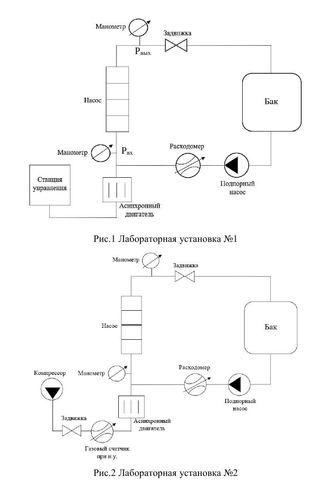
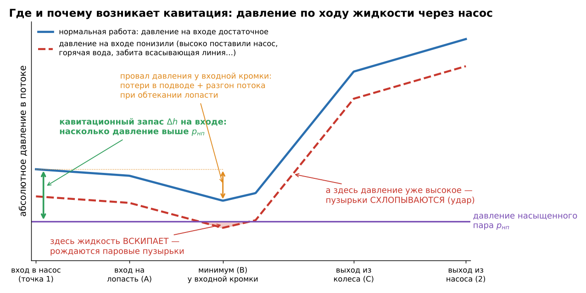
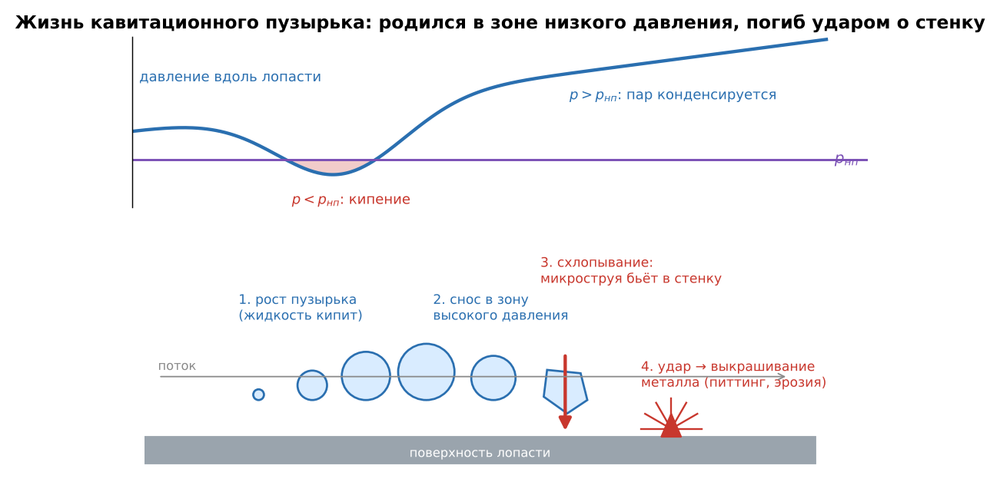
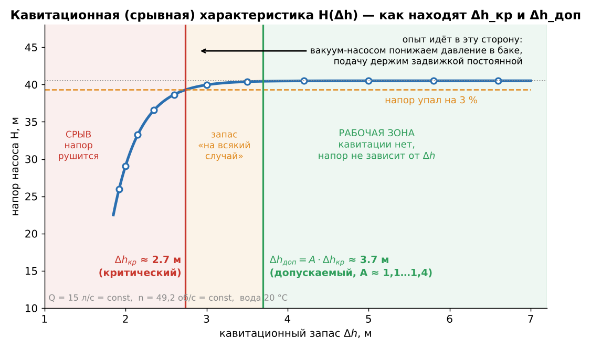
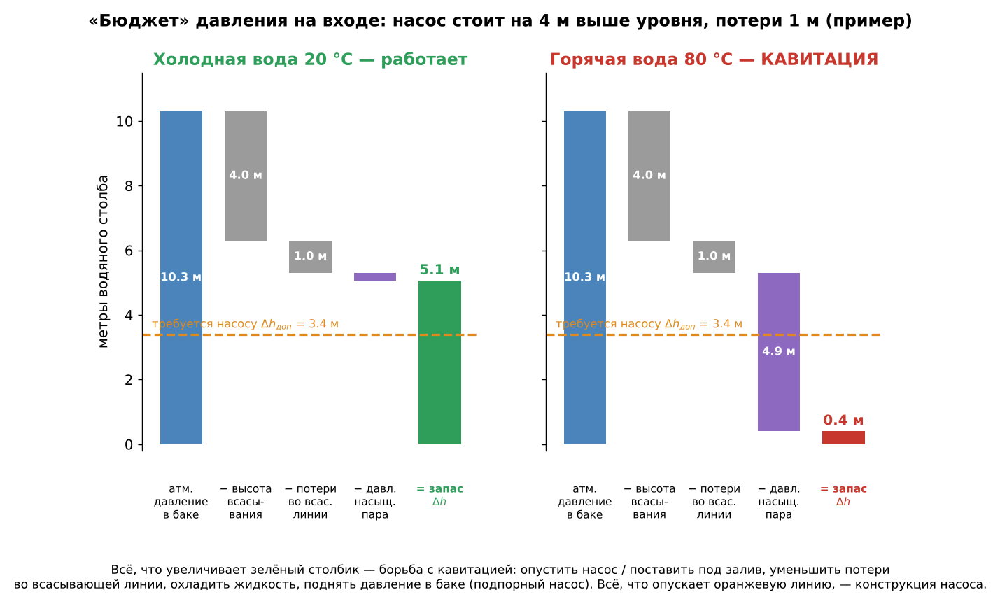
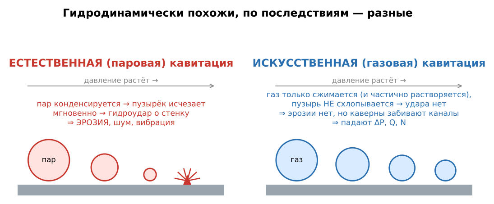
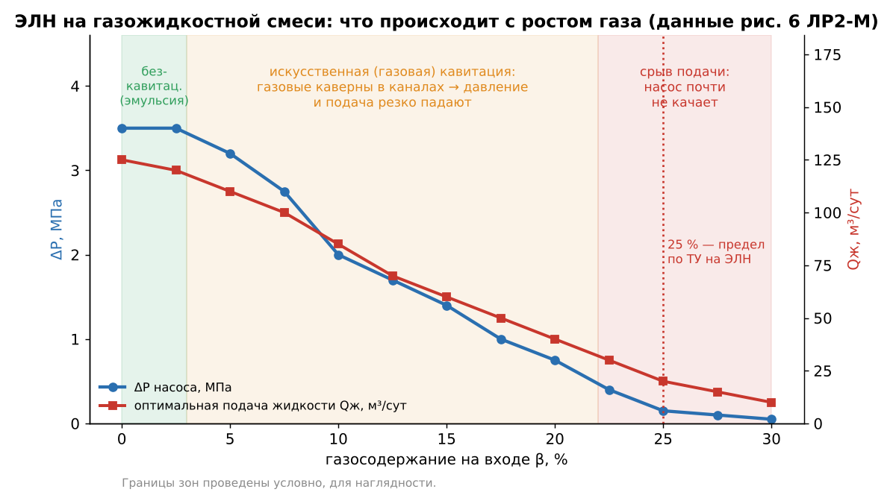

# ЛР2 «Перекачка насосом ГЖС» — подготовка к защите

*Источники: лекции (Тетрадь I, §2.20 «Кавитация в центробежных насосах»; Тетрадь II, испытания насосов), учебник Башты (гл. 14), методичка Ивановского, Долова, Шайхулова по ЭЛН на ГЖС. Формулы преподаватель не спрашивает — важно понимать процесс.*

## Что делали (сказать за 30 секунд)
Сняли характеристику скважинного насоса (ЭЛН) на воде: подача, давления на входе и выходе, мощность. Построили комплексную характеристику и нашли Q_опт по максимуму КПД. Потом от компрессора подавали во всас воздух и сняли то же на газожидкостной смеси (ГЖС) при постоянном давлении на входе. Его держал **подпорный насос** (в скважине это погружение под уровень). Повторили для двух давлений на входе. **Итог:** газ снижает давление насоса и мощность, а при большем давлении на входе газ вредит меньше.

*Стенды: №1 — вода; №2 — плюс компрессор и газовый счётчик на всасе.*

## ① Что такое кавитация и чем она вредит
**Суть:** у **входной кромки лопасти** колеса давление минимальное: поток там разгоняется при обтекании, плюс потери в подводе. Если оно падает до **давления насыщенного пара**, жидкость **вскипает** при обычной температуре. Пузырьки сносит дальше по колесу, в зону высокого давления, там пар конденсируется, и пузырёк **мгновенно схлопывается**: жидкость бьёт в точку смыкания, получается точечный гидроудар (до нескольких МПа). Это вскипание и схлопывание и есть кавитация.

**Вред:**
1. **Эрозия (питтинг)** — металл лопастей выкрашивается. Главная опасность, абсолютно стойких материалов нет.
2. **Шум, треск, вибрация**, при сильной кавитации — удары.
3. **Падают напор, подача, мощность, КПД**: паровая каверна на лопасти стесняет канал и портит обтекание.
4. **Срыв** — напор обрушивается, насос не качает.

**Дополнительно:** стадии — начальная (терпимо при стойких материалах), развитая и суперкавитация (нельзя). Сильнее всего страдает **первое колесо**, на входе в него давление минимальное.

**Как понять, что насос кавитирует:** треск («гравий внутри»), вибрация, скачут и падают давление на выходе и подача; на разобранном колесе — изъеденные лопасти у входа.

## ② Допускаемый кавитационный запас и как его найти
- **Кавитационный запас Δh** — насколько энергия жидкости на входе в насос больше давления её насыщенного пара (в метрах). Это «подушка», которую насос сам тратит на провал давления у кромки.
- **Критический Δh_кр** — запас, при котором кавитация уже заметно мешает работе: по ГОСТ — когда **напор падает на 3 %** (в лекциях, по старому ГОСТ, — на 2 %). Сами пузыри появляются раньше.
- **Допускаемый Δh_доп = (1,1…1,4)·Δh_кр** — критический с запасом «на всякий случай». Его наносят на характеристику насоса.
- **Как найти — опытом, по кавитационной характеристике** (график ниже). Стенд закрытый: n и Q держим постоянными (Q — задвижкой), а **вакуум-насосом ступенчато понижаем давление в баке**. Пока запас большой, напор не меняется, на графике полка. Дальше он падает и резко обрывается — это срыв. Проводим линию на 3 % ниже полки, точка пересечения — Δh_кр. Умножаем на коэффициент запаса и получаем Δh_доп.

- **Другие способы:** пересчёт с подобного насоса (**Δh ~ n²**); через коэффициент Руднева C (обычно 800–1000, со шнеком до 5000).
- **Зачем:** по нему выбирают **допустимую высоту всасывания** — как высоко можно поставить насос над уровнем или какой нужен подпор.
- **От чего зависит:** выше **температура** → больше давление пара → насос ставят ниже, вплоть до «под залив»; больше **обороты** или **подача** → насосу нужен больший запас.

## ③ Методы борьбы с кавитацией
| Дать насосу больше давления на входе | Уменьшить запас, который нужен насосу |
|---|---|
| поставить насос ниже уровня, при горячей жидкости — под залив | шире вход колеса, тонкие входные кромки |
| короткая и широкая всасывающая линия, мало колен, чистый фильтр | **предвключённый шнек** перед первым колесом |
| **не дросселировать на всасе** — регулировать только на напоре | колесо двустороннего входа |
| подпорный (бустерный) насос, наддув бака | плавный осесимметричный подвод, меньше скорости |
| холоднее жидкость (ниже давление пара) | **стойкие материалы**: Ni-Cr стали, а не чугун |
| работать около расчётной подачи, не завышать обороты | |

## Связь с нашей лабой (наверняка спросит)
- **Газосодержание β** — доля свободного газа в потоке на входе в насос, при давлении входа.
- Паровой кавитации на стенде не было: вода холодная, на входе подпор. Был газ, и он действует в два этапа:
  - **газа мало** — мелкие пузырьки перемешаны с водой (эмульсия). Характеристика почти как на воде, чуть ниже, потому что плотность смеси меньше;
  - **газа много** — пузыри сливаются в **газовые каверны** в каналах колеса. Сечение уменьшается, обтекание лопастей нарушается, ΔP, подача и мощность падают резко, вплоть до **срыва подачи**. Это **искусственная (газовая) кавитация**.
- Отличие от паровой: **газ не схлопывается**, а только сжимается, поэтому **эрозии нет**.

- Хуже всего, когда **больше газа**, **ниже давление на входе** (газ меньше сжат, занимает больший объём, β выше) и **малая подача** (центробежная сила гонит лёгкий газ к оси, ко входу, там он копится в пробку).
- При ~25 % газа насос почти не качает, поэтому по ТУ свободного газа на приёме ЭЛН **не более 25 %**.
- На ГЖС первые ступени многоступенчатого насоса почти не создают давления. Дальше газ сжимается и растворяется, и ступени «оживают».

## Короткие ответы по работе
- **Зачем подпорный насос?** Держит постоянное давление на входе; его меняют частотой вращения.
- **Зачем N_хх?** Это потери в подшипниках и сальниках (сборка без колёс); вычитаем, чтобы осталась мощность, ушедшая в ступени.
- **Почему газ пересчитываем к давлению входа?** Счётчик меряет при атмосферном давлении, а на входе газ сжат (Бойль–Мариотт). Давление берём абсолютное.
- **Почему ΔP–Q, а не H–Q?** Плотность смеси неизвестна и меняется по длине насоса, а давление меряется напрямую.
- **Почему падает мощность?** Насос качает меньшую массу (N ~ ρ).
- **Почему ЭЛН многоступенчатый?** Колесо ограничено диаметром скважины, одна ступень даёт всего 3–7 м.
- **Q_опт и рабочая область?** Q_опт — максимум КПД (через производную параболы); рабочая область — 0,75…1,25 Q_опт.
- **Как бороться с газом в скважине?** *(общ.)* Глубже погрузить насос, поставить газосепаратор или диспергатор.
