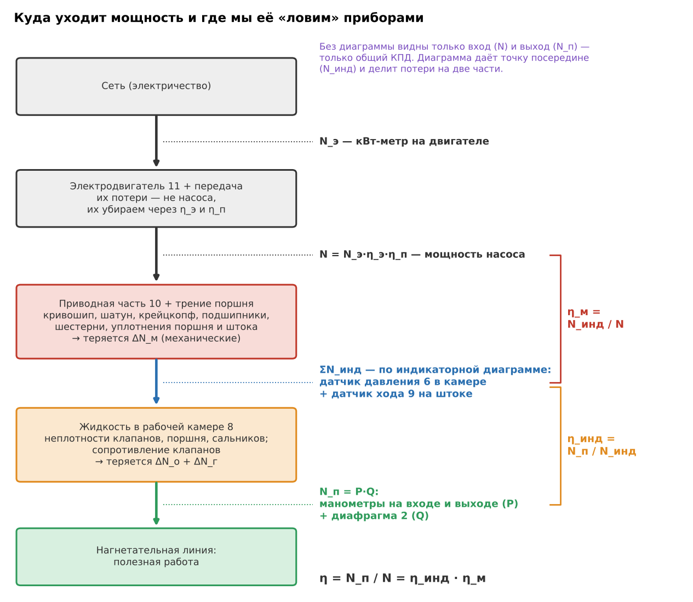
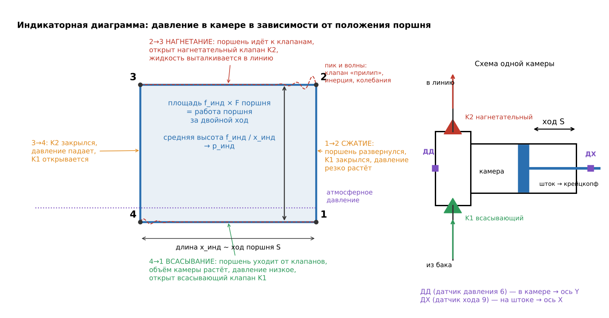
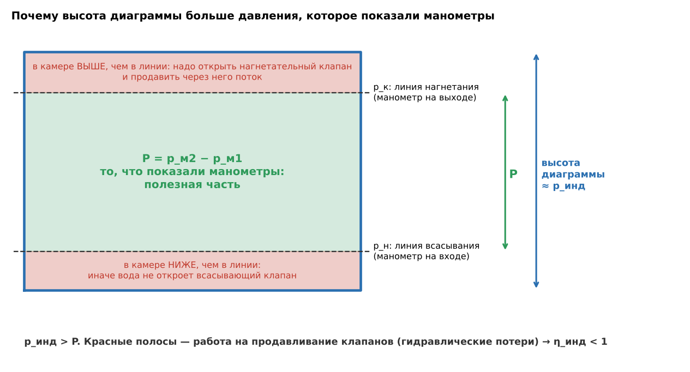
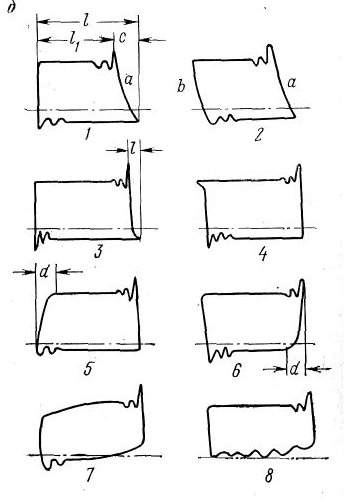
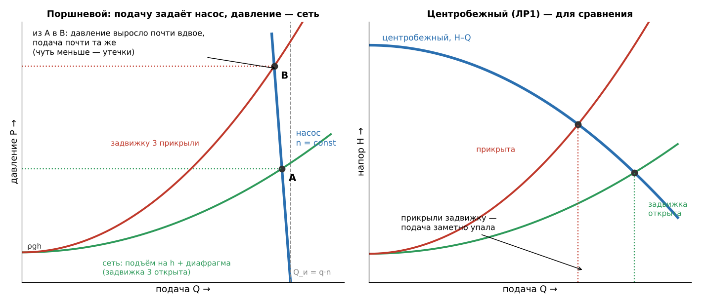
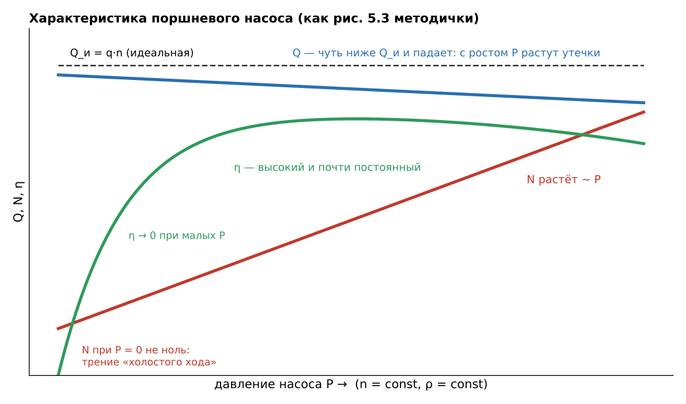
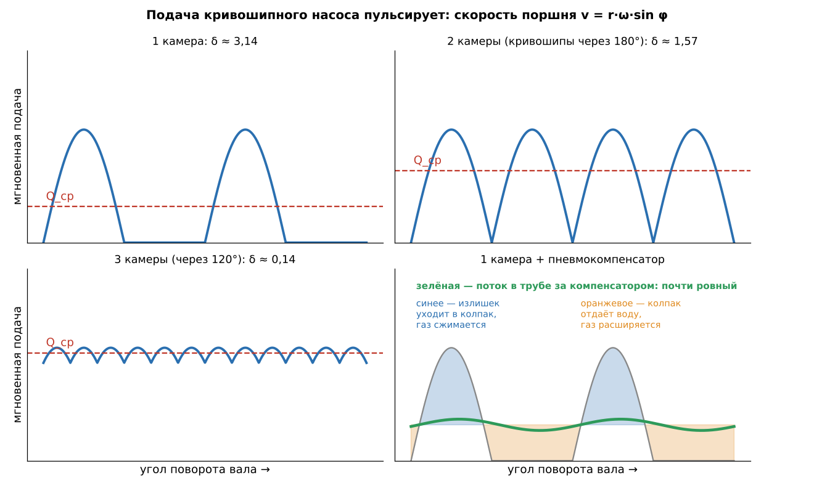

# ЛР3 «Испытание возвратно-поступательного (поршневого) насоса» — подготовка к защите

*Источники: методичка «Лабораторная работа 6. Испытание возвратно-поступательного насоса» (на портале — ЛР3), лекции (Тетрадь II, гл. 6–7), учебник Башты (гл. 18).*
⭐ — спросят почти наверняка; *(общ.)* — из общих знаний, в материалах курса этого нет.

## Что делали и зачем (сказать за 30 секунд) ⭐
Испытывали поршневой насос **в одном режиме**: при постоянной частоте ходов и постоянном давлении. Работа отвечает на два вопроса.
1. **Сколько насос подаёт и какой у него КПД.** Это измеряется снаружи: манометры дали давление P, диафрагма — подачу Q, ваттметр — мощность N. Отсюда полезная мощность N_п = P·Q и общий КПД η = N_п/N.
2. **Где теряется мощность.** Для этого заглянули внутрь: датчиками давления (в камере) и хода (на штоке) сняли **индикаторную диаграмму**, то есть давление в рабочей камере в зависимости от положения поршня. Её площадь даёт **индикаторную мощность N_инд**: сколько поршень реально передал жидкости. N_инд делит потери на **механические** (до поршня: трение) и **объёмно-гидравлические** (после поршня: утечки, клапаны). Отсюда частные КПД **η_м** и **η_инд**.

## ① Стенд: что где стоит и зачем ⭐ (контрольный вопрос 8)

*Рис. 5.4, а методички.*

**Вода ходит по замкнутому кругу:** бак 1 → задвижка 4 → пневмокомпенсатор 5 → насос (всасывающий клапан → камера → нагнетательный клапан) → пневмокомпенсатор 7 → задвижка 3 → вверх к диафрагме 2 → излив в бак. По схеме уровень воды в баке выше насоса, то есть вода подходит к насосу **с подпором**.

| № | Что | Зачем / как работает |
|---|---|---|
| 1 | бак | запас воды; вода идёт по кругу и сливается обратно через диафрагму |
| 4, 3 | задвижки на всасывающей и нагнетательной линии | отсекать насос от бака и линии; **на опыте обе открыты полностью** |
| 5 | пневмокомпенсатор на всасывающей линии | газовая подушка у входа: камера заполняется без провалов давления и разрыва потока |
| 7 | пневмокомпенсатор на нагнетательной линии | сглаживает пульсацию: ровный поток через диафрагму, ровное давление на манометре, меньше вибрации |
| 2 | расходомер: нормальная диафрагма в верхней точке линии | подача по перепаду давления; сразу за диафрагмой вода изливается в бак (там атмосфера) |
| 8 | гидравлическая часть | цилиндр с поршнем и клапанная коробка: всасывающий клапан снизу, нагнетательный сверху |
| 6 | датчик давления (ДД) **в рабочей камере** | давление внутри камеры, ось Y диаграммы |
| 9 | датчик хода (ДХ) на штоке | положение поршня, ось X диаграммы |
| 10 | приводная часть | кривошипно-шатунный механизм с крейцкопфом превращает вращение вала в ход штока; смазывается маслом под давлением от масляного насоса |
| 11 | электродвигатель | через передачу вращает коренной вал; мощность из сети — по кВт-метру |
| 12, 13 | манометры на щите, **на одной высоте** | давление на выходе и на входе; по схеме 12 подключён к нагнетательной линии (до задвижки 3), 13 — к всасывающей (после задвижки 4) |

**Электроника** (рис. 5.4, б). Датчик давления подключён через усилитель ко входу **Y** регистрирующего прибора, датчик хода — ко входу **X**. Блок питания даёт 12 В на датчик хода, всё вместе питается от 220 В. На экране компьютера получается график p(x), это и есть индикаторная диаграмма. Принтер печатает её для обработки.

## ② Как работает насос: один оборот вала ⭐ (контрольные вопросы 1, 5)
- **Привод.** Коренной вал вращается равномерно. Кривошип и шатун превращают вращение в возвратно-поступательное движение крейцкопфа и штока с поршнем. Крейцкопф принимает боковую силу от шатуна, поэтому шток идёт строго по оси и не перекашивается в уплотнении *(общ.)*. Ход S = 2r, где r — радиус кривошипа. **Один оборот вала — это двойной ход: одно всасывание и одно нагнетание** в каждой камере. **n — частота ходов**, она же частота вращения коренного вала, с⁻¹.
- **Поршень движется неравномерно:** v = r·ω·sin φ. В мёртвых точках скорость равна нулю, в середине хода максимальна. Отсюда пульсация подачи.
- **Клапаны самодействующие, привода у них нет.** Открывает их перепад давления, закрывают пружина и вес, когда поток останавливается. Именно клапаны по очереди соединяют камеру то с всасывающей, то с нагнетательной линией. Без них поршень просто гонял бы воду туда-обратно.

| Фаза (линия диаграммы) | Поршень | Клапаны | Давление в камере |
|---|---|---|---|
| **4→1 всасывание** | уходит от клапанов, объём камеры растёт | всасывающий открыт, нагнетательный закрыт | низкое: ниже, чем во всасывающей линии |
| **1→2 сжатие** | в мёртвой точке развернулся | оба закрыты | резко растёт, пока не откроется нагнетательный |
| **2→3 нагнетание** | вытесняет воду | нагнетательный открыт | высокое: выше, чем в нагнетательной линии |
| **3→4 расширение** | развернулся в другой мёртвой точке | оба закрыты | резко падает, пока не откроется всасывающий |

- ⭐ **Рабочий объём q** — изменение объёма всех рабочих камер за один оборот вала: **q = z·a·F·S**. Здесь F = πD²/4 — площадь поршня, S — ход, z — число рабочих камер (у насоса одностороннего действия оно равно числу поршней). **a** — поправка на шток. В насосе **одностороннего** действия работает одна сторона поршня, a = 1. В насосе **двустороннего** действия работают обе стороны, но со стороны штока площадь меньше (F − f), поэтому a = 1 − f/(2F).
- **Идеальная подача Q_и = q·n** — объём, который поршни «описывают» за секунду. Реальная подача Q меньше идеальной.

## ③ Индикаторная диаграмма — главное в работе ⭐ (контрольные вопросы 5, 6)
**Как её получили.** Датчик давления стоит прямо в рабочей камере, датчик хода — на штоке. Давление подаётся на вертикальную ось (Y), положение поршня — на горизонтальную (X). За один оборот вала точка на экране обходит замкнутую фигуру, каждый следующий оборот рисует её поверх. Диаграмму распечатали и обработали.

**Почему координаты «ход — давление», а не «время — давление».** На поршень действует сила p·F, на перемещении dx она совершает работу p·F·dx. Значит, **площадь фигуры в координатах x–p, умноженная на F, — это работа поршня за двойной ход**. На нагнетании поршень давит на воду при высоком давлении и отдаёт работу. На всасывании вода давит на поршень при низком давлении и часть работы возвращает. Разница и есть площадь. С осью времени так не получится: скорость поршня переменная.

⭐ **Что из неё считаем:**
- **Среднее индикаторное давление** — средняя высота диаграммы, переведённая в МПа: **p_инд = f_инд / (x_инд·a_инд)**, где f_инд — площадь (мм²), x_инд — длина (мм), a_инд — масштаб (мм/МПа). *Пример:* f = 15 см² = 1500 мм², x = 75 мм, средняя высота 20 мм; при a_инд = 10 мм/МПа получаем p_инд = 2,0 МПа. Горизонтальный масштаб не нужен: длина нужна только, чтобы найти среднюю высоту, а настоящий ход S подставляем потом.
- Площадь находят по клеткам или трапециями на распечатке (или программой), длину — между крайними точками.
- ⭐ **Индикаторная мощность ΣN_инд = z·p_инд·F·S·n.** По шагам: p_инд·F — средняя сила на поршне; умножив на S, получаем работу за оборот; на n — работу за секунду; на z — во всех камерах. Датчик стоит **в одной** камере, поэтому считаем, что остальные работают так же. В штоковой камере насоса двустороннего действия вместо F берут F − f.

⭐ **Почему высота диаграммы больше давления P, которое показали манометры**

Чтобы открыть нагнетательный клапан и продавить через него поток, давление в камере должно быть **выше**, чем в линии за насосом. Чтобы вода открыла всасывающий клапан и вошла, давление в камере должно быть **ниже**, чем в линии перед насосом. Поэтому **p_инд > P**, а разница — это гидравлические потери, в основном в клапанах. Для насоса одностороннего действия N_инд = p_инд·Q_и, и тогда **η_инд = N_п/N_инд = (P/p_инд)·(Q/Q_и)**. Здесь видны обе причины потерь: давление теряется на клапанах (P < p_инд), подача — на утечках (Q < Q_и).

**Реальная диаграмма — не прямоугольник, и каждая особенность что-то значит:**

| Что видно | Почему |
|---|---|
| линии 1→2 и 3→4 наклонены | вода немного сжимается (сильнее, если в ней воздух), стенки камеры упруго деформируются; вода в мёртвом пространстве сжимается, а потом расширяется |
| пик в точке 2 и провал в точке 4 | клапан «прилип» к седлу и обладает инерцией: чтобы его оторвать, нужен лишний перепад давления |
| волны на линиях 2→3 и 4→1 | клапан после открытия колеблется в потоке; сказывается инерция воды в трубах и пульсация, которую компенсаторы погасили не до конца |
| пунктир — линия атмосферного давления | если насос всасывает с разрежением, линия всасывания проходит ниже неё; при подпоре может быть выше |

**Диагностика.** Диаграмма — это «кардиограмма» насоса: её сравнивают с эталонной и находят неисправность, не разбирая насос (Т2).

*1 — с водой засосан воздух: сначала сжимается он (наклонная a), подача теряется на отрезке c. 2 — газовый мешок в камере. 3 — всасывающий клапан садится с запозданием. 4 — нагнетательный закрывается с запозданием. 5, 6 — клапаны негерметичны (наклонные участки d у мёртвых точек). 7 — волны: компенсатора нет или он не работает. 8 — на входе подпор выше атмосферного, неравномерный.*

## ④ Как меряли каждую величину и почему именно так ⭐ (контрольные вопросы 2, 3, 4)
**Давление насоса P = p_м2 − p_м1**
- По определению давление насоса — это прирост полной энергии жидкости (в Па): P = (p_к − p_н) + ρg(z_к − z_н) + ρ(c_к² − c_н²)/2.
- **Скоростную составляющую отбрасываем:** при скорости в трубе 1–2 м/с ρc²/2 ≈ 0,5–2 кПа, а P — порядка МПа.
- **Высоты отдельно учитывать не надо:** манометры стоят на щите **на одной высоте**, трубки к ним заполнены водой. По закону Паскаля каждый манометр показывает давление своего сечения, пересчитанное по столбу воды в трубке на высоту манометра. Раз высота у манометров одна, в разности их показаний ρg(z_к − z_н) уже учтено.
- Стрелки качаются, потому что подача пульсирует, — записываем **среднее** положение.
- Если на входе разрежение, p_м1 берём **со знаком минус** (P = p_м2 + |p_м1|). У нас по схеме насос стоит с подпором, так что на входе скорее избыточное давление.
- Если шкала не в СИ: 1 кгс/см² = 98066 Па; 750 мм рт. ст. = 0,1 МПа.

**Подача Q — диафрагмой (как в ЛР1)**
- Диафрагма — шайба с отверстием. В отверстии поток разгоняется, давление падает (уравнение Бернулли), перепад растёт как Q². Отсюда **Q = μ·f_д·√(2Δp_д/ρ)**, f_д = πd_д²/4. **μ** учитывает сжатие струи и потери; его берут по графику от d_д/d_к. График верен при **Re > Re_пр**, когда μ уже не зависит от Re. **ρ** — по температуре воды: **для этого и записывали температуру**.
- ⭐ **Особенность стенда:** отдельного дифманометра у диафрагмы нет. Диафрагма стоит в верхней точке линии, сразу за ней вода изливается в бак (там атмосфера). Значит, перепад на диафрагме равен избыточному давлению перед ней. Его считаем по манометру на выходе: **Δp_д = p_м2 − ρgh**, потому что часть давления уходит на подъём воды на высоту h от манометра до диафрагмы. Потерями в трубе и в открытой задвижке пренебрегаем. *(Наш вывод: поэтому задвижка 3 должна быть открыта полностью. Иначе часть давления «съест» она, и расход получится завышенным.)*

**Коэффициент подачи α = Q/Q_и** показывает, какая доля «описанного» поршнями объёма реально ушла в линию; по лекциям α = 0,85…0,98. **Что он учитывает:**
1. **Недозаполнение камеры** (коэффициент наполнения α_н): в воде есть воздух или газ (а при сильном падении давления на всасывании — пар); клапаны садятся с запозданием, и часть воды успевает уйти обратно; вода в мёртвом пространстве сжимается и расширяется, стенки пружинят.
2. **Утечки** (объёмный КПД η_о): через неплотные клапаны, мимо поршня из камеры нагнетания, через сальники штоков.
- **α = α_н·η_о.** С ростом давления растут утечки, и α падает. С ростом частоты ходов клапаны и вода хуже успевают, и α тоже падает.
- ⭐ Тонкость (Т2): **недозаполнение на КПД почти не влияет.** Если камера заполнилась не полностью, то и работы затрачено меньше: площадь диаграммы меньше, и в формуле η_инд = (P/p_инд)·(Q/Q_и) вместе с α падает и p_инд. **Утечки на КПД влияют:** воду сжали, потратили на это работу, а она ушла обратно.

**Частота ходов n — секундомером.** Считаем обороты коренного вала (двойные ходы) за 30–60 с: n = число оборотов / t, с⁻¹. Чем дольше считаем, тем меньше ошибка. Если перепутать одинарный ход с двойным, ошибка будет сразу вдвое.

**Мощность N — по кВт-метру.** Он показывает, сколько двигатель берёт из сети (N_э). До вала насоса доходит меньше: часть теряется в двигателе и в передаче. Поэтому **N = N_э·η_э·η_п**, где η_э и η_п — постоянные стенда.

## ⑤ Порядок испытания: каждое действие и зачем ⭐ (контрольный вопрос 9)
| Действие | Зачем |
|---|---|
| **1.** Включить усилитель, блок питания, компьютер, принтер; **прогреть 10 мин** | датчики и усилитель выходят на стабильный режим, иначе «плывут» ноль и масштаб диаграммы *(общ.)* |
| **2.** ⭐ **Проверить, что задвижки 3 и 4 открыты** | Объёмный насос **нельзя пускать на закрытую задвижку**. Он вытесняет объём, вода несжимаема, и давление растёт, пока не остановится двигатель или не разорвёт трубу или корпус (Т2). Если закрыта 4, камера не заполняется: разрыв потока, кавитация, удары. *У центробежного насоса в ЛР1 наоборот: его пускают при закрытой задвижке, потому что при Q = 0 его мощность минимальна* |
| Приоткрыть кран **охлаждающей воды** на штоки | шток трётся в уплотнении и греется; вода охлаждает шток и уплотнение *(общ.)* |
| **3.** Пустить двигатель, дать **3 мин на выход на режим**; проверить давление смазки **0,25–0,3 МПа** | за это время из камер уходит воздух, в компенсаторах устанавливается давление, режим перестаёт меняться; иначе замеры «гуляют» *(общ.)*. Масло под давлением идёт к подшипникам, шатуну, крейцкопфу; если давления нет — будет задир, насос сразу останавливают |
| **4.** Записать p_м1, p_м2 (среднее по качанию стрелки), n, N_э, температуру воды | всё на одном и том же режиме, почти одновременно |
| **5.** Снять индикаторную диаграмму | на **том же режиме**, что и показания манометров, иначе сравнивать p_инд с P (то есть считать η_инд) нельзя |
| **6.** Выключить двигатель, перекрыть воду, выключить приборы | охлаждение нужно, пока шток трётся, поэтому воду перекрывают уже после остановки *(общ.)* |

## ⑥ Обработка: цепочка расчёта и проверка себя ⭐ (контрольный вопрос 7)
**Постоянные стенда** (из «Данных установки»): z, S, D (→ F), d (→ f), a, q = z·a·F·S, a_инд, η_э, η_п, d_к, d_д, h. **Замеры:** p_м1, p_м2, N_э, n, температура воды, диаграмма.
1. Плотность ρ по температуре → Δp_д = p_м2 − ρgh → μ по d_д/d_к → **Q = μ·f_д·√(2Δp_д/ρ)**.
2. **Q_и = q·n** → **α = Q/Q_и**.
3. **P = p_м2 − p_м1**; **N = N_э·η_э·η_п**.
4. По диаграмме f_инд, x_инд → **p_инд = f_инд/(x_инд·a_инд)**.
5. **N_п = P·Q**; **ΣN_инд = z·p_инд·F·S·n**.
6. Потери: **ΔN_м = N − ΣN_инд** (механические); **ΔN_ог = ΣN_инд − N_п** (объёмно-гидравлические).
7. **η = N_п/N**; **η_инд = N_п/ΣN_инд**; **η_м = ΣN_инд/N**; проверка: **η = η_инд·η_м**.

Единицы: давление — в Па, подача — в м³/с (не в л/с); тогда Па·м³/с = Вт.

⭐ **Какие потери учитывает каждый КПД:**

| КПД | Какие потери | Где физически |
|---|---|---|
| **η_м = ΣN_инд/N**, механический | трение | подшипники, шестерни, шатун, крейцкопф приводной части; трение поршня о цилиндр и штока в уплотнении. Диаграмма «видит» только давление на поршень, поэтому всё трение остаётся до неё |
| **η_инд = N_п/ΣN_инд**, индикаторный (объёмно-гидравлический) | утечки и гидравлические сопротивления | неплотности клапанов, поршня, сальников; сопротивление клапанов и каналов камеры |

**Проверь себя: что должно получиться**
- Всегда **N > ΣN_инд > N_п**, все КПД и α меньше 1. Ориентиры: α = 0,85…0,98 (Т2); у промышленных насосов η_м ≈ 0,94…0,96, η_инд ≈ 0,87…0,9, η ≈ 0,8…0,92 (Башта); у вальных насосов в среднем η ≈ 0,75 (Т2). У маленького лабораторного насоса КПД может быть ниже.
- Если вышло α > 1 или η_м > 1, ищи ошибку. Типичные: в n посчитан одинарный ход вместо двойного; на масштаб a_инд умножили, а не разделили; забыли вычесть ρgh у диафрагмы; кгс/см² не перевели в Па; подставили л/с вместо м³/с.

## ⑦ Характеристика и регулирование: чем поршневой насос отличается от центробежного
⭐ **Подачу задаёт насос, давление — сеть.** За ход поршень вытесняет свой объём, а давление в линии устанавливается ровно такое, чтобы этот объём «пролез» через сеть. У нас сеть — это подъём воды на h и диафрагма. Если прикрыть задвижку 3, сопротивление вырастет: давление и мощность вырастут, а подача почти не изменится. У центробежного насоса (ЛР1) наоборот: прикрыли задвижку — и подача упала.

- Поэтому характеристику объёмного насоса строят **от давления P** при n = const (у центробежного — от подачи):
  - **Q** почти постоянна и слегка падает: с ростом P растут утечки.
  - **N** растёт почти линейно, так как N_п = P·Q, а Q ≈ const. При P = 0 мощность не нулевая: остаётся трение «холостого хода».
  - **η** высокий и почти постоянный в широком диапазоне давлений. При малых P он падает: механические потери почти не уменьшаются, а полезной мощности мало (Т2).
- Так характеристику и снимают: при n = const ступенями прикрывают задвижку на нагнетании и записывают точки. Это нагружение насоса для опыта, а не регулирование. **Мы сняли одну точку.**
- **Регулирование подачи:** частотой ходов (обороты двигателя, передаточное отношение), длиной хода, сменой втулок и поршней (диаметр D), перепуском части жидкости обратно на всасывание (неэкономично). **Задвижкой регулировать нельзя:** подача почти не меняется, а давление и мощность растут. Поэтому на нагнетании обязателен **предохранительный клапан**.

**Пульсация подачи и пневмокомпенсаторы**

- Подача одной камеры повторяет скорость поршня, то есть идёт полусинусоидой: половину оборота камера подаёт, половину — нет. Чем больше камер (кривошипы сдвинуты на 360°/z), тем ровнее подача; причём **нечётное число камер лучше**: 3 камеры дают более ровную подачу, чем 4 (Т2).
- Вред от пульсации: колебания давления, вибрация и усталость труб, удары. На всасывании давление может провалиться так, что вода оторвётся от поршня: камера недозаполнится, возникнет кавитация. Диафрагма на пульсирующем потоке тоже врёт *(общ.)*.
- **Пневмокомпенсатор** — колпак с газовой подушкой прямо у насоса. Когда насос даёт больше среднего, излишек уходит в колпак и газ сжимается. Когда меньше — газ расширяется и выталкивает воду обратно. В трубе за колпаком поток почти ровный. На стенде их два: **5** на всасывающей линии и **7** на нагнетательной.

## Ещё вопросы, которые могут задать
- **Чем поршневой насос принципиально отличается от центробежного?** Центробежный разгоняет жидкость колесом, поршневой **вытесняет** её. Отсюда: подача почти не зависит от давления; насос даёт большие давления (десятки МПа) при небольших подачах; может самовсасывать; подача пульсирует; пускают и работают с открытой задвижкой; регулируют оборотами, а не задвижкой.
- **Что будет, если на ходу прикрыть задвижку 4 (на всасывании)?** Давление в камере при всасывании упадёт, вода не успеет заполнить камеру (оторвётся от поршня, возможна кавитация). α упадёт, появятся удары. На диаграмме линия всасывания опустится, а подъём давления 1→2 затянется: сначала «дожимается» пустота.
- **Что будет, если увеличить частоту ходов?** Q_и растёт пропорционально n, но клапаны и вода хуже успевают, растут силы инерции на всасывании. α может упасть, растёт риск стука клапанов и кавитации; допустимая высота всасывания уменьшается (Т2).
- **Что такое мёртвое (вредное) пространство?** Объём камеры, который остаётся, когда поршень в крайнем положении (под клапанами, в каналах). Вода в нём на каждом ходе сжимается и расширяется. Отсюда наклон линий 1→2 и 3→4 и потеря подачи, особенно при высоком давлении и с воздухом в воде.
- **Почему η_м падает при малом давлении?** Трение в механизме почти не зависит от нагрузки, а полезная мощность мала, поэтому доля потерь растёт (Т2).
- **Почему N_инд нельзя найти без диаграммы?** Это работа поршня над водой. Ваттметр стоит до механизма, манометры — после клапанов, и ни то ни другое её не показывает. Нужно давление **внутри камеры** в каждой точке хода.
- **Где применяют поршневые насосы?** Там, где нужны высокие давления при умеренных подачах: буровые насосы (буровой раствор), цементировочные агрегаты, гидроразрыв пласта, закачка воды в пласт (Т2).
