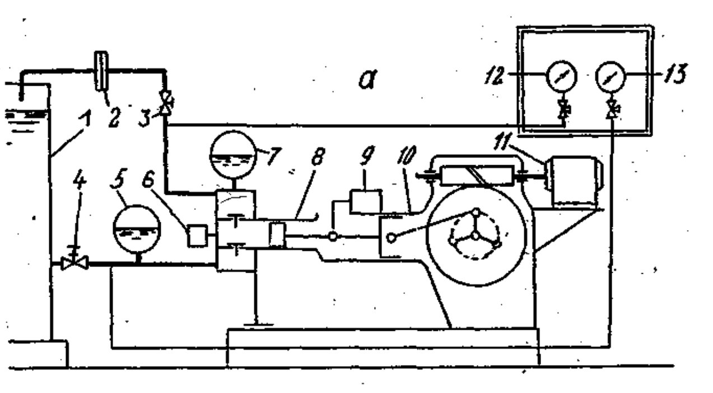
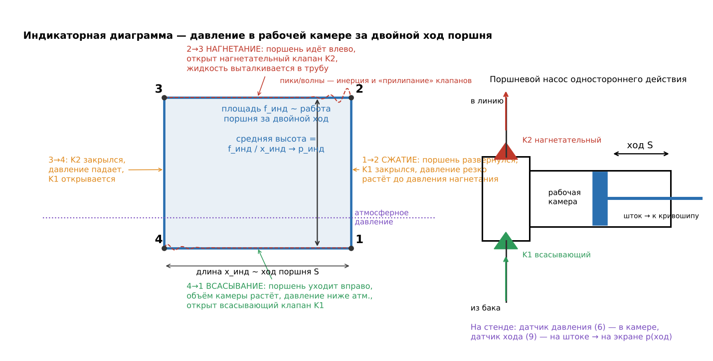
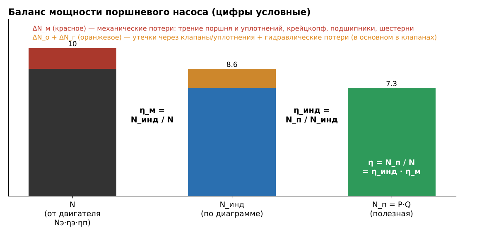
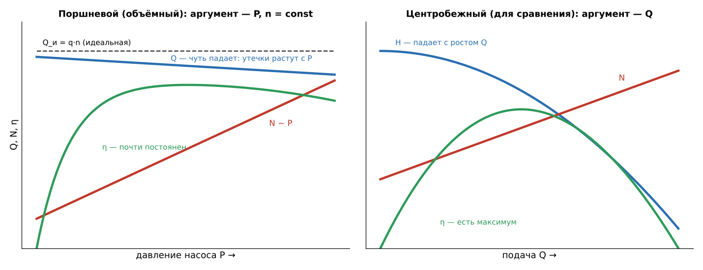
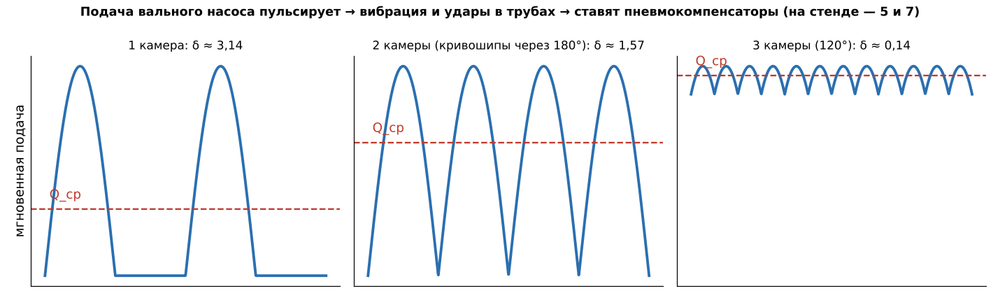

# ЛР3 «Испытание возвратно-поступательного (поршневого) насоса» — подготовка к защите

*Источники: методичка «Лабораторная работа 6. Испытание возвратно-поступательного насоса» (на портале — ЛР3), лекции Тетрадь II (гл. 6–7: устройство, подача, неравномерность, пневмокомпенсаторы, индикаторная диаграмма, КПД, характеристика). По ЛР2 преподаватель формул почти не спрашивал, важно было понимать процесс. Здесь формулы короткие, их стоит знать.*

## Что делали (сказать за 30 секунд)
Испытали поршневой насос в **одном режиме**: при постоянном давлении и постоянной частоте ходов. Записали манометры на входе и выходе, частоту ходов (секундомером) и мощность двигателя (ваттметром). Подачу посчитали по диафрагме на конце нагнетательной линии. На экране компьютера сняли **индикаторную диаграмму**: датчик давления стоит в рабочей камере, датчик хода на штоке. **Нашли:** подачу Q, коэффициент подачи α = Q/Q_и, давление P, мощность N, полезную N_п = P·Q, индикаторную N_инд по площади диаграммы, механические и объёмно-гидравлические потери, КПД η, η_инд и η_м.

*Стенд: 1 — бак; 2 — расходомер (диафрагма); 3, 4 — задвижки; 5, 7 — пневмокомпенсаторы (5 на всасе, 7 на нагнетании); 6 — датчик давления (ДД) в камере; 8 — гидравлическая часть насоса; 9 — датчик хода (ДХ); 10 — приводная часть; 11 — электродвигатель; 12, 13 — манометры на входе и выходе.*

## ① Как работает поршневой насос, рабочий объём
- **Объёмный насос**: жидкость попеременно **заполняет рабочую камеру и вытесняется** из неё поршнем. Камеру с трубами соединяют два **самодействующих клапана**: всасывающий и нагнетательный. Их открывает и закрывает сама жидкость перепадом давления.
- **Ход от кривошипа:** поршень уходит, объём растёт, давление падает ниже атмосферного, открывается всасывающий клапан. Поршень идёт обратно, давление растёт, всасывающий клапан закрыт, открывается нагнетательный, жидкость выталкивается в линию.
- **Рабочий объём q** — на сколько меняется объём всех камер за один оборот вала (двойной ход). **q = z·a·F·S**: z — число поршней (камер), F = πD²/4 — площадь поршня, S — ход, a — коэффициент, учитывающий шток (у одностороннего действия a = 1, у двустороннего a = 1 − f/(2F), f — площадь штока).
- **Одностороннего действия** — одна камера на поршень (одно всасывание и одно нагнетание за оборот). **Двустороннего** — камеры с обеих сторон поршня, со штоковой стороны объём меньше на f·S.
- **Отличия от центробежного:** самовсасывание; подача почти не зависит от давления; даёт **большие давления** при малых подачах; подача **пульсирует**.

## ② Индикаторная диаграмма ⭐ (точно спросит: «объясните процесс по диаграмме»)
**Что это:** запись **давления в рабочей камере** за двойной ход поршня, в координатах «ход — давление». Название от прибора-индикатора, у нас её строит компьютер по датчикам давления и хода.

- **4→1 всасывание:** давление в камере **ниже атмосферного** (сопротивление всасывающей линии, насос выше уровня в баке). Всасывающий клапан открыт.
- **1→2:** поршень в крайней точке развернулся, всасывающий клапан закрылся, давление **резко растёт** до давления нагнетания. Линия почти вертикальная. Наклон из-за **сжимаемости жидкости (воздух в ней) и упругости стенок**.
- **2→3 нагнетание:** открыт нагнетательный клапан, жидкость уходит в линию. В камере давление чуть выше, чем в трубе: это перепад на клапане. **Пик и волны в начале**: клапан надо оторвать от седла, он «прилип» и обладает инерцией, потом колеблется.
- **3→4:** нагнетательный клапан закрылся, давление падает, открывается всасывающий.
- **Площадь диаграммы ~ работе поршня за двойной ход**, средняя высота ~ **среднему индикаторному давлению**: p_инд = (f_инд / x_инд)·a_инд, где f_инд — площадь, x_инд — длина диаграммы, a_инд — масштаб давления (мм/МПа).
- **Индикаторная мощность** камеры: N_инд = p_инд·F·S·n. Для насоса — сумма по камерам: N_инд = z·p_инд·F·S·n.
- **Зачем ещё нужна:** **диагностика**. Сравнивают с эталонной и видят неисправности:

*(Т2, рис. 7.2, б) 1 — в жидкости воздух, сначала сжимается он (наклон a), подача теряется на отрезке c; 2 — газовый мешок в камере; 3 — запаздывает посадка всасывающего клапана; 4 — запаздывает закрытие нагнетательного; 5, 6 — неплотность клапанов (наклон у мёртвых точек d); 7 — волны: нет компенсатора или он не работает; 8 — подпор на входе выше атмосферного, с пульсацией.*

## ③ Подача и коэффициент подачи
- **Как мерили Q:** диафрагмой на конце нагнетательной линии, как в ЛР1: Q = μ·f_д·√(2Δp_д/ρ). После диафрагмы жидкость сливается в бак, там давление атмосферное. Поэтому перепад на диафрагме = избыточное давление перед ней: **Δp_д = p_м2 − ρgh** (h — на сколько диафрагма выше манометра). μ — по графику от d_д/d_к.
- **Идеальная подача** Q_и = q·n: объём, который «описали» поршни в единицу времени.
- ⭐ **Коэффициент подачи α = Q / Q_и** (обычно 0,85…0,98). **Что учитывает** (почему Q < Q_и):
  1. **Неполное заполнение камеры** (коэффициент наполнения α_н): воздух и газ в жидкости, пар при кавитации; **запаздывание закрытия клапанов** (часть жидкости уходит обратно); **расширение жидкости в мёртвом пространстве** и упругость стенок.
  2. **Утечки** (объёмный КПД η_о) через неплотности клапанов, уплотнения поршня и сальники штоков.
  Итого α = α_н · η_о. α_н на КПД не влияет (мощность на недоиспользованный объём не тратится), утечки влияют.

## ④ Давление, мощности, баланс и КПД ⭐
- **Давление насоса** P = p_к − p_н (полные давления на выходе и входе). Скоростной напор не учитываем, манометры на одной высоте, трубки заполнены → **P = p_м2 − p_м1** (при вакууме на входе p_м1 со знаком минус). **У объёмных насосов работают с давлением P, а не с напором H.**
- **Мощность насоса** (на валу): N = N_э·η_э·η_п (мощность из сети × КПД двигателя × КПД передачи).
- **Полезная** N_п = P·Q.

- **Баланс:** N = N_п + ΔN_м + ΔN_о + ΔN_г.
  - ΔN_м = N − N_инд — **механические** потери: трение в паре цилиндр–поршень, уплотнения штока, крейцкопф, подшипники, зубчатая передача **приводной части**.
  - ΔN_ог = N_инд − N_п — **объёмные и гидравлические** потери: утечки и сопротивление (в основном **клапанов**).
- **КПД:** η = N_п / N; **η_инд = N_п / N_инд** (индикаторный, он же объёмно-гидравлический: η_инд = η_г·η_о); **η_м = N_инд / N** (механический). **η = η_инд · η_м** (у вальных насосов η ≈ 0,75…0,9).
- **Что где учитывается (контрольный вопрос 7):** **индикаторный КПД** — утечки и гидравлические потери, всё, что происходит **внутри с жидкостью** (по диаграмме). **Механический** — трение в механизме, от вала до поршня.

## ⑤ Характеристика, пульсация, регулирование (могут спросить «в общем»)

- Характеристику объёмного насоса строят **от давления P** при n = const: **Q почти постоянна** и чуть падает (с давлением растут утечки), **N растёт линейно** с P, **η высокий и почти постоянный** в широком диапазоне.
- **Регулирование:** частотой ходов (обороты двигателя), сменой втулок/поршней (D), длиной хода S. **Дросселировать задвижкой нельзя**: подача почти не изменится, давление и мощность вырастут, может разорвать линию.
- **Пуск и работа — с открытой задвижкой на нагнетании** (у центробежного — с закрытой!). Если перекрыть линию, давление растёт до разрушения, поэтому ставят **предохранительный клапан**. Поэтому в пункте «убедиться, что задвижки 3 и 4 открыты».

- **Подача пульсирует**: скорость поршня от кривошипа меняется по синусу, от нуля в мёртвых точках до максимума в середине хода. Это даёт вибрацию труб, удары, усталость, а на всасе может сорвать подачу. Чем больше камер, тем ровнее; **нечётное число лучше** (3 ровнее, чем 4). Кривошипы смещают на 360°/z.
- **Пневмокомпенсатор** (воздушный колпак): ёмкость с газовой подушкой у насоса. При избытке подачи газ сжимается и принимает жидкость, при недостатке отдаёт. В трубе за ним поток почти равномерный. На стенде их два: **5 на всасывающей** и **7 на нагнетательной** линии.

## Короткие ответы по работе
- **Приборы и датчики стенда?** Манометры на входе (12) и выходе (13), диафрагменный расходомер (2), ваттметр (кВт-метр) на двигателе, секундомер или счётчик ходов, датчик давления в камере (6) и датчик хода (9) → усилитель → компьютер (индикаторная диаграмма), манометр масляного насоса смазки.
- **Порядок испытания?** Включить электронику, прогреть 10 мин → проверить, что задвижки 3 и 4 открыты, пустить охлаждающую воду на штоки → включить двигатель, дать поработать 3 мин, проверить давление смазки привода (0,25–0,3 МПа) → записать манометры, частоту ходов, мощность → снять индикаторную диаграмму → выключить двигатель, перекрыть воду, выключить приборы.
- **Зачем охлаждающая вода?** *(общ.)* Охлаждает и смазывает штоки и их уплотнения (сальники), чтобы не грелись от трения.
- **Зачем масляный насос?** Смазка приводной части: кривошипно-шатунный механизм, крейцкопф, подшипники, шестерни.
- **Почему p_м1 может быть отрицательным?** На входе вакуум: насос сам всасывает из бака, давление в линии ниже атмосферного.
- **Почему Δp_д = p_м2 − ρgh?** За диафрагмой сразу слив в бак (атмосфера), а диафрагма выше манометра на h. Часть давления уходит на подъём жидкости на эту высоту.
- **Мёртвое (вредное) пространство** — объём камеры, который остаётся при крайнем положении поршня (под клапанами, каналы). Жидкость и газ в нём сжимаются и расширяются, отсюда наклон линий диаграммы и потеря подачи.
- **Почему поршневые насосы на буровой и для закачки?** *(общ. + Т2 гл. 6)* Большие давления (десятки МПа) при умеренных подачах, высокий КПД, могут качать вязкие и абразивные жидкости (буровой раствор).
- **Почему η_инд можно найти только по диаграмме?** N_инд — работа поршня над жидкостью. Ни манометры, ни ваттметр её не показывают, только давление в самой камере в зависимости от хода.
